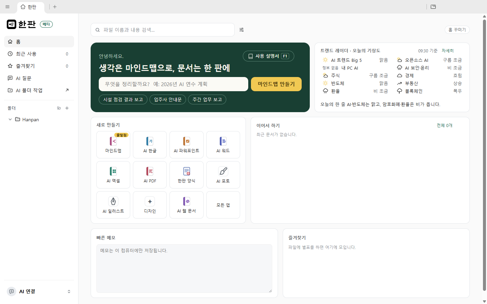
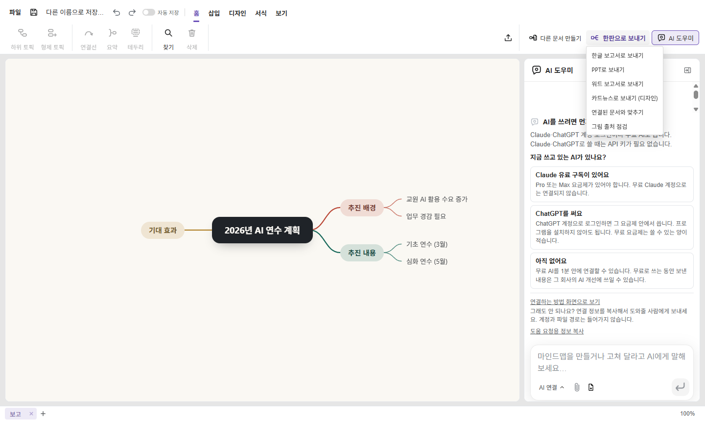
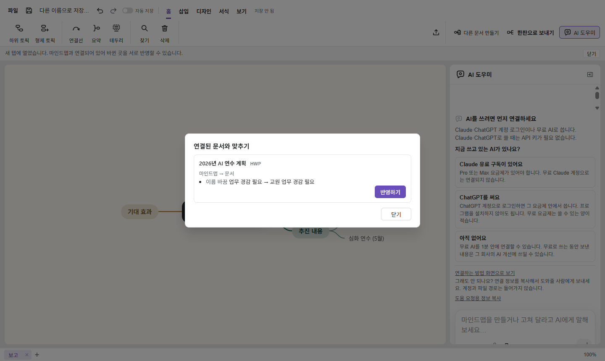
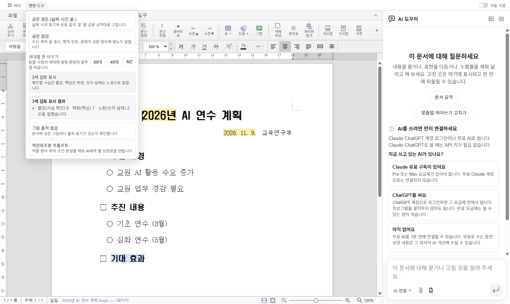
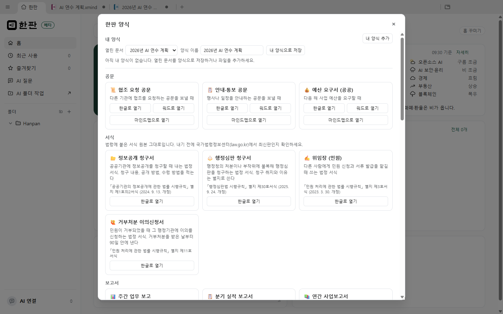
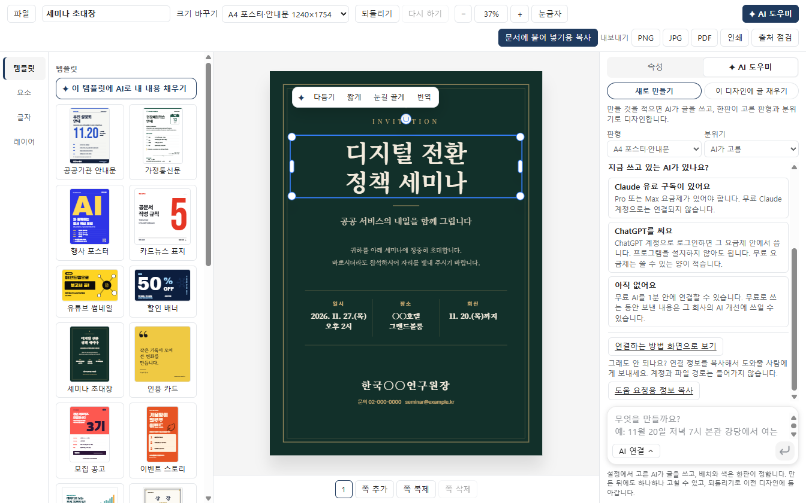

# 한판 사용 매뉴얼

> 기준: 한판 0.20.0(2026-11-13 main 병합본), Windows 11 한국어 화면. Mac·Linux판(베타)과 다른 곳은 따로 적었다.
> 읽는 사람: 한판을 처음 쓰는 직장인, 이 매뉴얼로 교육 콘텐츠를 만드는 사람.
> 한판이 무엇이고 왜 이렇게 만들었는지는 [프로젝트 이해](프로젝트이해.md)에 있다. 이 문서는 "어디를 누르면 무엇이 나오는지"를 다룬다.

**읽는 법**: 굵은 글씨는 화면 문구 그대로다. `›`는 "그 안의"라는 뜻이다(예: **설정 › AI**). 단계는 번호대로 한 번에 하나씩 한다. 이름에 "AI"가 붙은 기능은 AI를 먼저 연결해야 하고(2장), 나머지는 인터넷 없이 이 PC 안에서 처리한다.

## 차례

1. [설치와 첫 실행](#1-설치와-첫-실행) · 2. [AI 연결](#2-ai-연결) · 3. [홈](#3-홈) · 4. [모든 편집기 공통](#4-모든-편집기-공통) · 5. [마인드맵](#5-마인드맵)
6. [AI 한글과 한판 양식](#6-ai-한글과-한판-양식) · 7. [AI 워드·엑셀·파워포인트·마크다운·웹 문서](#7-ai-워드엑셀파워포인트마크다운웹-문서) · 8. [PDF](#8-pdf)
9. [AI 디자인](#9-ai-디자인) · 10. [AI 포토와 AI 일러스트](#10-ai-포토와-ai-일러스트) · 11. [설정](#11-설정) · 12. [업데이트](#12-업데이트)
13. [자주 막히는 곳과 해결](#13-자주-막히는-곳과-해결) · 14. [자주 묻는 질문](#14-자주-묻는-질문) · [용어 풀이](#용어-풀이) · [부록](#부록-a-기능-대조표)

## 1. 설치와 첫 실행

결론: 설치 → 이용 조건 동의 → 보안키 만들기 → 처음 안내, 네 화면을 지나면 홈이 열린다. 처음 한 번만 한다.
#### 1-1. 설치하기 (Windows)
준비물: Windows 10 이상 64비트 PC. 설치 파일은 약 243MB다(0.19.5 기준, 2026-11-12 측정).
1. 브라우저에서 `https://github.com/tenaico/hanpan/releases/latest`를 연다.
2. `Hanpan-Setup-0.20.0.exe`를 내려받는다.
3. 내려받은 파일을 두 번 누른다.
4. 파란 "Windows의 PC 보호" 창이 뜨면 **추가 정보**를 누른다.
5. **실행**을 누른다.
6. 설치 화면의 **사용권 및 면책 안내**를 읽는다(무료 오픈소스, 있는 그대로 제공, 사용자 책임, AI가 만든 내용, 보안키, 보내는 정보 6개 항목).
7. 동의 단추를 누른다.
8. 설치할 폴더를 확인하고 끝까지 진행한다.
- 주의: "PC 보호" 창은 설치 파일에 코드 서명(배포자 증명서)이 아직 없어서 뜬다. 위 주소에서 받은 파일만 실행한다.
- Mac은 같은 페이지의 `.dmg`, Linux는 AppImage·deb·rpm을 받는다. 둘 다 베타이고 보안키가 없다.
#### 1-2. 이용 조건에 동의하기
처음 켜면 모든 운영체제에서 **한판을 쓰기 전에** 창이 뜬다.
1. 네 줄을 읽는다. 무료·있는 그대로 제공 / 문서 손실·AI 요금·API 키 유출·보안키 분실은 사용자 책임(TEN AI의 고의로 생긴 손해는 예외) / AI가 만든 내용은 초안 / 회원 정보·문서·AI 대화를 TEN AI로 보내지 않음.
2. 전문이 궁금하면 **전체 사용권 보기**를 누른다.
3. **위 내용을 읽고 동의합니다.** 칸에 체크한다.
4. **동의하고 계속**을 누른다.
- 동의 기록은 이 PC에만 남는다. 이용 조건이 바뀐 판으로 업데이트하면 한 번 더 묻는다.
#### 1-3. 보안키 만들기 (Windows만)
**보안키**는 한판을 여는 열쇠 파일이다. 비유하면 "현관 열쇠와 금고 열쇠를 한 꾸러미로 묶은 것"이다. 보안키가 있어야 한판이 열리고, 한판에 넣은 API 키(2-5절)도 이 보안키로 잠긴다. 왜 넣었는지는 [프로젝트 이해 7장](프로젝트이해.md#7-왜-이렇게-만들었나) Q4에 있다. 동의 다음에 **보안키를 만드세요** 화면이 뜬다.

| 고르는 것 | 열리는 조건 | 좋은 점 | 위험 |
|---|---|---|---|
| **USB에 만들기**(권장) | USB를 꽂았을 때만 | USB를 뽑아 두면 같은 PC를 쓰는 사람이 내 API 키를 못 쓴다 | USB를 잃어버리면 되살릴 수 없다 |
| **이 PC에 만들기** | 언제나 바로 | USB가 필요 없다 | 이 PC를 쓰는 누구나 한판과 내 API 키를 쓸 수 있다 |

**USB에 만들기**
1. 쓸 USB를 PC에 꽂는다.
2. **USB에 만들기**를 고르고 **다음**을 누른다.
3. **USB를 고르세요** 목록에서 USB(예: **USB (E:)**)를 고른다. 목록이 비면 USB를 다시 꽂고 **다시 확인**을 누른다.
4. **보안키 만들기**를 누른다. "만드는 중…"이 지나면 다음 화면으로 넘어간다.
- USB에 `Hanpan` 폴더와 보안키 파일 두 개가 생긴다. 다른 파일은 건드리지 않는다. 예비 USB를 하나 더 만들어 두면 안전하다(1-5절).

**이 PC에 만들기**
1. **이 PC에 만들기**를 고르고 **다음**을 누른다.
2. **이 PC에 보안키를 만들까요?** 창의 경고를 읽는다.
3. 위험 동의 칸 **이 PC를 쓰는 다른 사람이 한판과 내 API 키를 쓸 수 있으며, 그로 인한 요금과 피해는 제 책임임을 이해했습니다.**에 체크한다.
4. **이 PC에 만들기**를 누른다. 마음이 바뀌면 **USB로 할게요**를 누른다.
- Claude·ChatGPT 구독 로그인은 각 회사 프로그램이 따로 관리하며 보안키와 관계없다.
- 보안키는 PC 출입을 막지 않는다. 다른 사람이 PC를 못 쓰게 하려면 Windows 잠금(Windows 키+L)을 함께 쓴다.
- TEN AI는 보안키를 보관하지 않으므로 잃어버린 보안키를 되살려 줄 수 없다.
#### 1-4. 켤 때마다: USB 꽂기와 잠금
1. 한판을 켠다. USB가 없으면 **보안키 USB를 꽂아 주세요** 화면이 뜬다.
2. 보안키 USB를 꽂는다. 바로 열린다. 안 열리면 **다시 확인**을 누른다.
3. 쓰는 도중 USB를 뽑으면 창마다 **보안키를 확인할 때까지 한판이 잠겨 있습니다** 덮개가 덮인다. 다시 꽂으면 풀린다.
- **등록하지 않은 USB입니다**가 나오면 보안키를 만든 USB가 아니다. 원래 USB를 꽂거나 예비 USB로 등록한다.
#### 1-5. 예비 USB·옮기기·잃어버렸을 때
보안키 관리는 **설정 › 일반** 맨 아래 **보안키** 카드에 있다. "USB에 있습니다"/"이 PC에 있습니다", 만든 날, 등록한 USB 개수가 보인다.

**예비 USB 만들기**
1. 새 USB를 꽂는다.
2. **예비 USB 만들기**를 누른다.
3. **쓸 USB**에서 새 USB를 고르고 진행한다. "완료했습니다."가 나오면 끝이다.

**USB로 옮기기 / 이 PC로 옮기기**
1. 보안키 카드에서 **USB로 옮기기**(또는 **이 PC로 옮기기**)를 누른다.
2. USB로 옮길 때는 **쓸 USB**를 고르고, 이 PC로 옮길 때는 위험 동의 칸에 체크한다.
3. 진행 단추를 누른다.

**USB를 잃어버렸을 때(새 보안키 만들기)**
1. 한판을 켜고 **보안키 USB를 꽂아 주세요** 화면에서 **USB를 잃어버렸나요?**를 누른다.
2. **새 보안키 만들기**를 누른다.
3. **새 보안키를 만들까요?** 창의 네 줄을 읽는다(문서·설정은 남음 / 넣어 둔 API 키는 지워짐 / 구독 로그인은 그대로 / 예전 USB는 다시 찾아도 못 씀).
4. **넣어 둔 API 키가 지워진다는 것을 이해했습니다.**에 체크한다.
5. **새로 만들기**를 누르고 1-3절처럼 새 보안키를 만든다.
6. API 키를 썼다면 2-5절대로 다시 넣는다.
- 설정의 보안키 카드에서 **새 보안키 만들기**를 눌러도 된다. 한판이 다시 시작되고 처음 실행 화면에서 만든다.
#### 1-6. 처음 안내
1. **한판에 오신 것을 환영합니다**를 읽고 **다음**을 누른다.
2. **AI 연결** 장에서 지금 쓰는 AI(Claude 유료 구독 / ChatGPT / 아직 없어요)를 고르고 2장처럼 연결한다. 나중에 하려면 **다음**을 누른다.
3. **준비가 끝났습니다**에서 **시작하기**를 누른다. 홈이 열린다.
- 다시 보려면 **설정 › 일반 › 처음 안내 다시 보기**의 **보기**를 누른다.

## 2. AI 연결

결론: 이미 쓰는 Claude·ChatGPT 구독으로 로그인하거나, 이 PC에 깔린 AI(내 PC AI)를 쓴다. 한판은 사람이 고르지 않은 유료 방식으로 스스로 넘어가지 않는다.

네 가지 길(구독, API 키, 무료 한도, 내 PC AI)의 돈·보안 차이는 [프로젝트 이해 2-6절](프로젝트이해.md#2-6-ai를-쓰는-네-가지-길-구독-api-키-무료-한도-내-pc-ai)에 있다. 추천: 문서를 밖으로 보내면 안 되면 내 PC AI, 구독이 있으면 구독, 둘 다 없으면 무료로 시작. 설정은 홈 왼쪽 아래 줄(연결 전에는 "AI 연결")을 눌러 연다.
#### 2-1. Claude 구독으로 연결
준비물: Claude Pro 또는 Max 요금제(무료 계정은 안 된다).
1. **설정 › AI › 구독 연결**의 Claude 카드를 본다.
2. "설치되지 않음"이면 **설치**를 누르고, 새 터미널 창의 공식 설치가 끝날 때까지 기다린다.
3. "로그인 필요"가 되면 **로그인**을 누른다.
4. 브라우저의 Claude 로그인 화면에서 로그인하고 허용을 누른다.
5. 한판으로 돌아온다. 카드가 "연결됨"이 된다. 안 바뀌면 **다시 확인**을 누른다.
- 브라우저가 안 열리면 **브라우저가 열리지 않았나요?**를 누른다. 로그인 창에 코드를 붙여 넣을 때는 창 안에서 마우스 오른쪽 단추를 누른 뒤 Enter를 누른다(붙여 넣은 코드가 안 보이는 것이 정상).
#### 2-2. ChatGPT 요금제로 연결
1. **설정 › AI › 구독 연결**의 ChatGPT 카드에서 **ChatGPT로 계속**을 누른다.
2. 브라우저의 ChatGPT 로그인 화면에서 로그인한다.
3. 이 앱이 ChatGPT 요금제를 쓰도록 허용한다. 카드가 "연결됨"이 된다.
- 10분 안에 끝내지 않으면 처음부터 다시 한다. 이 PC에서 Codex 프로그램을 쓰고 있으면 Codex 카드로 연결해도 된다.
#### 2-3. 구독 없이 무료로 쓰기
**설정 › AI › 무료로 쓰기**에 두 카드가 있다. 하루 한도가 있고, 보낸 내용이 그 회사의 AI 개선에 쓰일 수 있으니 개인정보가 든 문서는 보내지 않는다.
1. OpenRouter: **브라우저로 연결**을 누르고, 브라우저에서 가입·로그인한 뒤 허용을 누른다. 카드에 "오늘 무료 요청 N번 중 M번 남음"이 보이면 끝이다.
2. Google Gemini(18세 이상): **키 만들기**를 눌러 Google AI Studio에서 키를 만든다.
3. 그 키를 "Gemini 키를 붙여넣으세요" 칸에 붙여 넣고 **연결**을 누른다.
- 결제가 연결된 Google 프로젝트에서 만든 키는 요금이 나갈 수 있다.
#### 2-4. 내 PC AI 쓰기
내 PC AI는 내 컴퓨터 안에서 도는 AI다. 문서가 PC 밖으로 나가지 않고 돈이 들지 않는 대신 PC 성능이 필요하다. 한판은 켤 때 이 PC의 AI 서버(Ollama, LM Studio, vLLM, llama.cpp)를 찾아, 따로 고른 AI가 없으면 "Ollama (내 PC)"처럼 등록해 쓴다.
1. `https://ollama.com`에서 Ollama를 설치한다.
2. 명령 프롬프트에서 한국어 모델을 받는다. 예: `ollama pull exaone3.5:7.8b`
3. 한판을 끄고 다시 켠다.
4. 자동으로 안 잡히면 **설정 › AI › 로컬 AI**에서 **서버 추가**를 누른다.
5. **서버 종류**를 고르고 **주소**를 확인한다(Ollama는 보통 `http://localhost:11434`).
6. **모델 목록 새로 고침**을 누르고 모델을 고른다.
7. **연결 테스트**를 누르고 서버·모델·대화·도구 호출이 "통과"인지 본다.
- 도구 호출이 통과하지 않는 모델은 문서를 직접 고치지 못하고 글만 제안한다. 주소가 다른 컴퓨터면 "문서가 이 서버로 전송됩니다."가 보인다.
#### 2-5. API 키로 쓰기(고급)
API 키는 AI 회사가 발급하는 긴 문자열 열쇠이고, 쓴 만큼 요금이 나간다(비유: 법인카드 번호).
1. **설정 › AI** 맨 아래 **고급**을 펼친다.
2. **AI 모델**에서 **제공업체**를 고른다(Anthropic, Gemini, DeepSeek, OpenAI 호환 서버 등).
3. **API 키**를 붙여 넣고 **모델**을 고른다.
4. **연결 테스트**를 눌러 "연결 성공"을 확인한다.
5. **저장**을 누른다.
6. 위에 **이 AI 쓰기**가 나오면 누른다. 누르기 전에는 키가 쓰이지 않는다.
- 키는 이 PC에만 저장되고, Windows에서는 보안키로 한 번 더 잠긴다. 보안키를 새로 만들면 다시 넣는다.
#### 2-6. 쓸 AI 고르기
1. **설정 › AI › 사용할 AI**를 연다.
2. **자동**으로 두면 연결된 구독(Claude, ChatGPT, Codex 순서)을, 구독이 없으면 내 PC AI를 쓴다. 요금이 나가는 연결은 자동으로 고르지 않는다.
3. 직접 고르면 모든 편집기가 그 AI를 쓰고 한판이 다시 바꾸지 않는다. 각 AI 창 아래 모델 목록에서도 바꾼다.
- 고른 AI를 못 쓰면 다른 AI로 넘어가지 않고 이유를 보여 준다. 다른 구독이 있으면 **ChatGPT로 계속** 같은 단추가 나온다.
- 무엇이 어디로 가는지는 **설정 › AI › AI 개인정보 안내(밖으로 보내는 것)**의 **다시 보기**에 있다.

## 3. 홈

결론: 홈은 카드를 늘어놓은 첫 화면이다. 새 문서를 만들고, 최근 문서를 열고, 오늘의 트렌드로 AI 브리핑을 받는다. 어디서든 왼쪽 메뉴 맨 위 **홈**으로 돌아온다.

#### 시작 카드: 주제로 마인드맵 만들기
1. "무엇을 정리할까요?" 칸에 주제를 적는다. 예: `11월 2주차 주간 업무 보고`
2. **마인드맵 만들기**를 누른다. 그 주제가 가운데인 마인드맵이 새 탭에 열린다.
- 예시 단추(시설 점검 결과 보고, 입주사 안내문, 주간 업무 보고)를 눌러도 된다.
#### 트렌드 레이더 · 오늘의 기상도
1. 카드에서 분야별 오늘의 날씨와 **오늘의 한 줄**을 읽는다.
2. 분야를 누르면 브라우저에 그 분야 화면이, **자세히**를 누르면 트렌드 레이더 첫 화면이 열린다.
- 인터넷이 없으면 마지막으로 받은 기상도를 "11월 12일 기준"처럼 보여 준다. 한국어 화면에서만 처음부터 놓여 있다.
#### AI 브리핑: 오늘의 기상도로 문서 만들기
1. 트렌드 카드의 **AI 브리핑**을 누른다.
2. **브리핑 형식 고르기**에서 **Word**, **한글(HWP)**, **마인드맵**, **PowerPoint**, **PDF** 가운데 고른다.
3. "쓰는 중…"이 끝나면 새 탭에 저장 안 된 문서가 열린다. 헤드라인, 현황 요약, 1~3개월 전망, 체크포인트가 들어 있고 기사를 근거로 쓴 문장 끝에 [1] 같은 번호가 붙는다.
4. 숫자를 확인하고 저장한다.
- 이 PC에 받아 둔 기상도를 2장에서 고른 AI에 한 번 보낸다. 기상도에 없는 숫자는 쓰지 않게 검사하지만 결과는 초안이다. "AI가 브리핑을 쓰지 못했습니다."가 나오면 잠시 뒤 다시 누른다.
#### 새로 만들기와 모든 앱
1. **새로 만들기** 카드에서 앱을 누른다. 새 문서가 열린다.
2. 다른 앱은 마지막 칸 **모든 앱**을 누른다.
3. "앱 이름이나 하는 일로 찾기" 칸에 적거나 **최근에 쓴 앱**에서 고른다.
4. 앱 옆 핀 단추로 홈에 고정하거나 뺀다.
- 모든 앱은 네 묶음 15가지다. **문서 만들기**(마인드맵, AI 한글, AI 파워포인트, AI 워드, AI 엑셀, AI 마크다운, AI 웹 문서, 한판 양식), **PDF · 변환**(AI PDF, PDF 도구, 마크다운 변환기), **그림**(AI 포토, AI 일러스트, AI 디자인), **파일**(로컬 파일 열기). 한국어가 아닌 화면에서는 AI 한글·한판 양식·AI 디자인이 숨는다(11-3절).
#### 이어서 하기 · 빠른 메모 · 즐겨찾기
1. **이어서 하기** 카드에서 최근 문서를 누른다. **전체 N개**를 누르면 **최근 사용** 화면으로 간다.
2. **빠른 메모** 카드에 적는다. 이 PC에만 저장된다.
3. 파일 줄에 마우스를 올려 별표를 누른다. **즐겨찾기**에 모인다. 줄의 **⋯ › 그룹으로 이동…**으로 그룹을 만든다.
#### 홈 꾸미기와 카드 추가
1. 보드 오른쪽 위 **홈 꾸미기**를 누른다.
2. 카드를 끌어 옮기고, 오른쪽 아래 모서리를 끌어 크기를 바꾼다.
3. **카드 추가**로 빠른 메모, 즐겨찾기, 폴더 보기, 시계·날짜, 바로가기 카드를 더한다(24장까지).
4. **완료**나 Esc를 누른다.
- **기본 배치로**는 처음 배치로 돌린다(직접 더한 카드는 남는다). **목록으로 정리**는 마우스 없이 ↑↓로 순서를 바꾸는 창이다.
#### 파일 검색
1. 맨 위 "파일 이름과 내용 검색…" 칸에 검색어를 적는다.
2. 결과를 누르면 열린다. Esc를 누르면 보드로 돌아온다.
- 찾기용 색인은 이 PC 안에만 있다. "파일 N개 색인 중…"이 끝나면 결과가 더 나온다.
#### 최근 사용 · 즐겨찾기 화면과 폴더
1. 왼쪽 메뉴의 **최근 사용**이나 **즐겨찾기**를 누른다. 파일이 표로 나온다.
2. 위쪽 거르기(문서, 마인드맵·그림 등)로 종류를 고른다.
3. 줄의 **⋯**에서 **폴더에서 보기**, **이름 바꾸기**, **복사본 만들기**, **폴더로 이동…**, **삭제** 가운데 고른다.
4. 자주 쓰는 폴더는 **폴더 추가…**로 왼쪽 메뉴에 넣고, **새 폴더**로 하위 폴더를 만든다.
- 삭제는 실제 파일을 Windows 휴지통으로 옮긴다. **목록에서 제거**는 목록에서만 뺀다.
#### AI 질문: 즐겨찾기 파일에 묻기
1. 묻고 싶은 파일에 별표를 붙인다.
2. 왼쪽 메뉴 **AI 질문**을 누른다. 필요하면 **묻는 범위**에서 그룹을 고른다.
3. "즐겨찾기한 파일에 대해 질문…" 칸에 묻고 Enter를 누른다. 예: `작년 연수 계획서에서 예산 항목만 뽑아 줘`
4. 답의 출처를 누르면 그 파일이 열린다. 남기려면 **마크다운으로 저장**이나 **Word로 저장**을 누른다.
- 대화는 저장되지 않고 앱을 다시 켜면 지워진다.
#### AI 폴더 작업(고급)
폴더 속 파일을 Claude Code·Codex가 직접 읽고 고친다. Claude 구독이나 Codex 연결이 필요하다(바로 연결한 ChatGPT로는 안 된다).
1. 왼쪽 메뉴 **AI 폴더 작업**을 누른다. 새 창이 열린다.
2. **폴더 고르기…**로 자료 폴더를 고른다.
3. **프로그램**에서 Claude Code나 Codex를 고른다.
4. **언제 물을까요**는 처음 값(**명령 실행마다 묻기**)으로 둔다.
5. 처음 한 번 안내를 읽고 **이해했습니다**를 누른다.
6. **시작**을 누르고 할 일을 적어 **보내기**를 누른다.
7. 명령을 실행하려 할 때 뜨는 창에서 **허락**이나 **거절**을 누른다.
- Windows에서 Claude Code는 허락한 명령이 PC 전체에 닿을 수 있다. 무엇을 하려는지 읽고 허락한다.

## 4. 모든 편집기 공통

결론: 어느 문서를 열어도 탭 메뉴, 화면 나누기, 공유, 다른 앱으로 보내기, AI 도우미, 자동 저장은 같은 방식이다.
#### 탭 메뉴
1. 위쪽 탭을 마우스 오른쪽 단추로 누른다.
2. **저장**, **다른 이름으로 저장…**, **인쇄…**, **이름 바꾸기**, **복사본 만들기**, **경로 복사**, **파일 이름 복사**, **폴더에서 보기**, **기본 앱으로 열기**, **다른 탭 닫기**, **닫힌 탭 다시 열기** 가운데 고른다.
- 탭을 두 번 누르면 그 자리에서 이름을 바꾼다. Ctrl+Tab은 다음 탭, Ctrl+W는 탭 닫기.
#### 화면 나누기
1. 탭을 창의 오른쪽(또는 아래쪽) 가장자리로 끌어 놓는다. 탭 메뉴 **오른쪽에 나누기**·**아래에 나누기**도 같다.
2. 가운데 구분선을 끌어 비율을 바꾼다(두 번 누르면 반반).
3. 끝내려면 탭 메뉴 **나누기 풀기**를 누른다.
- 탭을 탭 줄 밖으로 끌어내면(또는 **새 창에서 열기**) 따로 떨어진 창이 된다.
#### 공유하기
1. 문서를 저장한다.
2. 탭 메뉴 **공유하기…**를 누른다.
3. Windows 공유 창에서 메일·메신저 앱을 고른다.
- 저장 안 한 변경이 있으면 **저장하고 공유**를 먼저 묻는다.
#### 다른 앱으로 보내기
지금 문서 내용을 다른 편집기의 새 문서로 옮긴다. 예: 워드 보고서를 PPT 초안으로.
1. 탭 메뉴(또는 ☰ 메뉴)의 **다른 앱으로 보내기**에 마우스를 올린다.
2. 보낼 편집기를 고른다. 옮기기 전에 다듬으려면 **마크다운으로 먼저 보고 고치기**를 고른다.
3. 새 탭에 제목 없는 문서가 열린다. 원래 문서는 그대로다.
- 마크다운(제목·목록만 남는 가벼운 글 형식)을 거치므로 복잡한 서식은 빠진다. 파워포인트로는 100장까지.
#### 이 문서로 새 문서 만들기 · 자료 보기
1. 파일 메뉴의 **이 문서로 새 문서 만들기**를 누른다. **새 문서 만들기** 창이 뜬다.
2. **만들 종류**(PPT·웹 문서·마인드맵)를 고른다.
3. 필요하면 **파일 더하기…**로 자료를 더한다(20개까지, 하나에 50MB까지).
4. **원하는 내용**을 적고(비워도 됨) **만들기**를 누른다. 새 탭에서 그 편집기의 AI가 문서를 만든다.
- 만든 문서의 파일 메뉴 **자료 보기**는 쓴 자료를, 원래 문서의 **이 문서로 만든 문서**는 만든 문서를 보여 준다.
#### 내 양식으로 저장
1. 워드·한글 문서를 저장한다.
2. 탭 메뉴 **내 양식으로 저장…**을 누른다.
3. **양식 이름**을 적고 저장한다. 6장 한판 양식의 **내 양식**에 나온다.
#### 내보내기
1. 파일 메뉴에서 **PDF로 내보내기…**, **이미지로 내보내기…**, **단일 파일 HTML로 내보내기…** 같은 항목을 고른다(편집기마다 다르다).
2. 저장할 곳을 고른다. 원본은 바뀌지 않는다.
#### AI 도우미(AI 창)
말로 부탁하면 AI가 그 편집기의 편집 도구로 문서를 직접 고친다.
1. 리본의 AI 단추로 AI 창을 연다.
2. 바꿀 곳을 고르고 부탁을 적는다. 예: `이 문단을 개조식으로 바꿔 줘`
3. Enter를 누른다. 바뀐 곳이 표시된다.
4. 마음에 들지 않으면 되돌린다(워드는 AI 창의 버전 목록, 그 밖은 Ctrl+Z).
5. 다른 문서를 자료로 붙이려면 입력 칸에서 `@`를 치고 고른다. PC의 파일은 📎 단추로 붙인다.
- 저장하지 않은 문서는 `@`로 붙일 수 없다. 구독 한도의 80%를 넘으면 "85% 사용 · 오후 3:00에 초기화" 같은 줄이 보인다.
#### 스킬 부르기
스킬은 AI에게 주는 작업 설명서다. 되풀이하는 일을 같은 방식으로 시킨다.
1. AI 입력 칸 맨 앞에서 `/`를 친다. 켜진 스킬 목록이 뜬다.
2. 글자를 쳐서 좁힌다. 예: `/회의록` → `meeting-minutes`
3. Enter로 고르면 입력 칸 위에 칩으로 붙는다.
4. 할 일을 적고 보낸다. 예: 회의 메모를 붙여 넣고 `정리해 줘`
- 기본 스킬 5개: 회의록 정리(`meeting-minutes`), 공지·소식지 쓰기(`internal-comms`), AI 티 나는 표현 다듬기(`humanizer`), 영어 글 다듬기(`copy-editing`), 스킬 찾기(`find-skills`, AI 폴더 작업 창 전용). 추가와 끄기는 11-2절.
#### 가리기: AI에게 보이지 않게
1. 슬라이드·마크다운·웹 문서에서 숨길 부분을 고른다.
2. 마우스 오른쪽 단추 › **선택 영역을 AI에게 숨기기**를 누른다.
3. 자리표시자 이름(예: `고객명`)을 정한다. AI는 `{{고객명}}`만 본다.
- 파일 내용과 인쇄는 그대로다. 워드 편집기에는 이 기능이 없다.
#### 자동 저장과 복구
1. **설정 › 일반 › 모든 문서 자동 저장**을 켠다. 편집기 위쪽 **자동 저장** 스위치로도 켜고 끈다(한 번 저장한 문서부터).
2. 정전이나 멈춤으로 꺼졌으면 한판을 다시 켠다. 탭이 돌아오고 홈에 **저장하지 않은 내용이 남아 있는 문서** 목록이 뜬다.
3. 문서마다 **되살리기**나 **버리기**를 고르고 **확인**을 누른다. 정하기 어려우면 **나중에 정하기**를 누른다.
- 저장 안 한 변경은 약 30초마다 복구 사본으로 남는다. 암호가 걸린 엑셀·한글·PDF는 사본이 없으니 자주 저장한다.
#### 사용 설명서
1. F1을 누른다.
2. 목차 맨 위 **한판 시작하기**를 누르거나 검색 칸에 찾는 말을 적는다.

## 5. 마인드맵

결론: 생각을 마인드맵으로 정리한 뒤 단추 하나로 한글 보고서·PPT·워드·카드뉴스를 만든다. 한글 문서와는 연결되어 어느 쪽을 고쳐도 서로 맞춘다.
#### 마인드맵 편집
1. 가운데 주제를 고르고 **홈 › 하위 토픽**으로 큰 가지를 만든다.
2. **같은 단계 토픽**으로 옆 가지를 더한다.
3. 토픽을 두 번 눌러 글을 고친다.
4. **서식**에서 배치(오른쪽·왼쪽·양쪽·아래·나무·시간 순)와 테마를 고른다.
5. Ctrl+S로 저장한다. `.xmind` 파일이라 XMind에서도 열린다.
#### 찾기·바꾸기
1. Ctrl+F를 누르고 찾을 말을 적는다. Enter는 다음, Shift+Enter는 앞이다. 메모·라벨까지 찾으려면 **메모·라벨도**를 켠다.
2. 바꾸려면 Ctrl+H를 누르고 바꿀 말을 적은 뒤 **모두 바꾸기**를 누른다.
#### 꾸미기 도구
1. 그림: 토픽을 고르고 **삽입 › 그림**으로 PNG·JPG·GIF(10MB까지)를 넣는다.
2. 아이콘: **삽입 › 아이콘** 패널에서 우선순위·진행률·깃발·별을 누른다. 다시 누르면 뗀다.
3. 서식: **스타일** 탭에서 모양·채우기·글꼴·가지 선을 바꾼다. **서식 복사**를 누르고 다른 토픽을 누르면 옮겨진다.
4. 테두리: 같은 토픽 아래 가지들을 고르고 **홈 › 테두리**를 누른다.
5. 정렬: **서식 › 정렬**로 바로 아래 가지를 가나다순으로 놓는다(한 번 더 누르면 거꾸로).
6. 보기: **보기 › 단계별 보기**로 1·2·3단계만 펼치고, **보기 › 보이기**로 메모·그림 등을 화면에서만 감춘다.

#### 한글 보고서로 보내기
1. 도구 줄 오른쪽 **한판으로 보내기 (한글·PPT·워드)** 단추를 누른다.
2. **한글 보고서로 보내기**를 고른다.
3. 양식을 고른다. 개조식 보고서(□ ○ ― ·) / 장 나눈 보고서(Ⅰ. Ⅱ. 아래 □ ○) / 공문 번호(1. 가. 1) 가)).
4. 글꼴과 부서·작성자를 정한다. 날짜는 `2026. 11. 13.`처럼 오늘이 들어간다.
5. 내용에서 **마인드맵에 적은 말 그대로** 또는 **AI가 문장으로 살 붙이기**를 고른다.
6. **보내기**를 누른다. 새 탭에 `.hwpx` 문서가 열린다. 처음 저장할 때 저장할 곳을 묻는다.

| 마인드맵 | 한글·워드 보고서 | PPT |
|---|---|---|
| 중심 주제 | 제목 + 날짜·부서 줄 | 표지 |
| 큰 가지 | □ 항목(장 보고서면 Ⅰ.) | 슬라이드 한 장의 제목 |
| 그 아래 가지 | ○ → ― → · | 글머리 항목 |
| 메모 | 항목 아래 설명("※"로 시작하면 참고 줄) | 발표자 노트 |

실제 예: 큰 가지 "이번 주 한 일" 아래 "신규 계약 1건(1,100만 원)"을 적고 AI 살 붙이기로 보내면 `□ 이번 주 한 일` / `○ 신규 계약 1건(1,100만 원)을 체결함`이 된다. 개조식 규칙은 [프로젝트 이해 2-3절](프로젝트이해.md#2-3-문서-종류별-만드는-순서)에 있다.
#### PPT로 보내기
1. 보내기 메뉴에서 **PPT로 보내기**를 고른다.
2. **슬라이드 스타일** 10가지 가운데 고른다(처음 값은 "결론 먼저 보고서").
3. 내용에서 **AI가 스타일에 맞춰 슬라이드 글 쓰기**를 고르면 제목·핵심 한 줄·발표자 노트를 AI가 쓴다.
4. **청중**에 발표 대상(예: `임원진`)을 적는다. 비워도 된다.
5. **보내기**를 누른다. 표지, 목차(큰 가지 3개 이상), 큰 가지마다 한 장, 마무리 슬라이드가 생긴다.
- 스타일: 큰 글자 한 줄 메시지, 결론 먼저 보고서, 쉬운 말 카드형, 컨설팅 프레임워크형, 이야기 중심 발표, 색 포인트 정보형, 블록형 미니멀, 따뜻한 경험 이야기, 균형 잡힌 템플릿형, 투자 제안 피치덱. "기본 (꾸밈 없음)"은 흰 바탕 글머리 슬라이드다.
- 마인드맵에 없는 숫자·이름은 짓지 않고 노트에 "확인할 자료: …"로 남긴다. 한 장에 항목이 9개를 넘으면 "(계속)" 장으로 나뉜다.

#### 워드 보고서로 보내기
1. 보내기 메뉴에서 **워드 보고서로 보내기**를 고른다.
2. 양식·글꼴·내용을 한글과 같은 방식으로 고르고 **보내기**를 누른다. `.docx` 보고서가 새 탭에 열린다.
#### 카드뉴스로 보내기
1. 보내기 메뉴에서 **카드뉴스로 보내기 (디자인)**를 고른다.
2. AI 디자인 창에 표지 한 장과 큰 가지마다 카드 한 장이 생긴다. 고치는 법은 9장.
#### 연결된 문서와 맞추기

1. 마인드맵이나 보낸 한글 문서 가운데 한쪽을 고친다.
2. 보내기 메뉴에서 **연결된 문서와 맞추기**를 누른다.
3. 바뀐 곳을 확인한다("마인드맵 → 문서", "문서 → 마인드맵", "양쪽에서 다르게 고친 곳").
4. 양쪽에서 다르게 고친 곳은 마인드맵 쪽 / 문서 쪽 / 나중에 가운데 고른다.
5. **반영하기**를 누른다.
- 한글 문서만 된다. 문서에서 직접 쓴 본문 문장은 덮어쓰지 않고 □ ○ 같은 항목만 주고받는다. 문서가 닫혀 있으면 파일에 저장하고 이전 파일을 `.bak`으로 남긴다.
#### 그림 출처 점검
1. 보내기 메뉴에서 **그림 출처 점검**을 누른다.
2. "「토픽」: 그림의 출처가 메모에 없습니다."가 나온 토픽의 메모에 출처를 적는다.
#### 발표와 내보내기
1. 지도로 발표하려면 **보기 › 발표**를 누른다. Esc로 끝낸다.
2. 파일로 남기려면 **내보내기**에서 **이미지로 내보내기…**, **PDF로 내보내기…**, **마크다운 개요로 내보내기…** 가운데 고른다.

## 6. AI 한글과 한판 양식

결론: 한글 문서(.hwp·.hwpx)를 한판에서 바로 열어 고치고, 공문 규칙 점검은 AI 없이 단추로 한다. 빈 종이 대신 양식 22가지와 법령 서식 4가지에서 시작한다.
#### 한글 문서 열고 고치기
1. 홈 **AI 한글**을 누르거나 `.hwp`·`.hwpx` 파일을 창에 끌어 놓는다.
2. 글을 고친다. AI 창에 "2번 항목을 공문 말투로 고쳐 줘"처럼 부탁해도 된다.
3. Ctrl+S로 저장한다. `.hwp`와 `.hwpx` 가운데 고른다.
- 한컴 글꼴(HY헤드라인M 등)이 PC에 없으면 화면에만 대체 글꼴로 보인다. 파일에는 글꼴 이름이 들어가 한컴 한글에서는 원래 모양이다.

아래 **한판 도구**는 한글 탭 위쪽 띠에 있다. AI 없이 이 PC 안에서 처리하고 결과를 탭에 바로 보여 준다. 마음에 안 들면 저장하지 않고 닫는다. 표 칸 안의 글은 바꾸지 않는다.
#### 공문 정돈
1. **한판 도구 › 공문 정돈 (날짜·시간·끝.)**을 누른다.
2. 날짜가 `2026. 5. 8.`, 시각이 `14:30`으로 바뀌고 본문 끝에 " 끝."이 붙었는지 본다.
#### 공문 점검
1. **한판 도구 › 공문 점검**을 누른다.
2. 수신·제목 줄, 끝 표시, 날짜 표기, 항목 번호 차례(1. 가. 1) 가)), "~합니다/~한다" 섞임 알림을 고친다. 맞으면 "공문 양식에 맞습니다."가 나온다.
#### 세대별 톤 바꾸기
1. **한판 도구 › 세대별 톤 바꾸기**를 누른다.
2. 60대(정중한 경어체)·40대(간결)·MZ(짧고 발랄) 가운데 고른다. 어미가 바뀐다.
#### 3색 검토 표시
1. **한판 도구 › 3색 검토 표시**를 누른다. 빨강(추정·약·전망처럼 확인이 필요한 말), 파랑(핵심·반드시·목표), 노랑(숫자·날짜·금액)이 칠해진다.
2. 노랑 숫자를 원자료와 하나씩 대조한다.
#### 역관목조분 프롬프트
역할·관련분야·목적·조건·분량을 채워 AI 요청문(프롬프트)을 짜는 방법이다.
1. **한판 도구 › 역관목조분 프롬프트**를 누른다.
2. 칸을 채운다. 예: 역할 `구청 홍보 담당`, 목적 `주민 설명회 안내문`, 분량 `A4 1쪽`.
3. 유형(요약·정리·분석·생성·설명)을 고르고 복사한다.
4. AI 창에 붙여 넣는다.
#### 그림 출처 점검(한글)
1. **한판 도구 › 그림 출처 점검**을 누른다.
2. 출처 없는 그림, 이용 조건이 있는 그림, 끝의 "그림 출처" 목록에 빠진 그림을 본다.
3. [가기]로 그 그림에 가고, 빠진 것은 [목록에 넣기]로 더한다.
#### 공유마당 그림을 AI로 넣기
공유마당은 한국저작권위원회의 무료 저작물 서비스다. 먼저 9장 "공유마당 그림 넣기" 1~2단계로 키를 넣는다.
1. AI 창에 `공유마당에서 씨름 그림을 찾아 넣어 줘`라고 적는다.
2. 그림이 들어갔는지 본다. 그림 아래 출처 줄과 끝의 "그림 출처" 목록은 AI가 아니라 한판이 적는다.

#### 한판 양식 22가지
1. 홈 **새로 만들기 › 한판 양식**을 누른다.
2. 종류(공문, 보고서, 제안서, 회의록·메모, 사업기획, 교육, 콘텐츠)에서 양식을 찾는다. 예: "주간 업무 보고".
3. **한글로 열기**, **워드로 열기**, **마인드맵으로 열기** 가운데 누른다.
4. ○○○ 자리를 실제 내용으로 바꾼다.
- 교육 양식의 옛 그림은 공유마당의 저작권 만료·CC BY 작품이다. 그림마다 붙은 출처 줄은 지우지 않는다.
#### 법령 서식 4가지
1. 한판 양식의 **서식** 묶음을 연다(정보공개 청구서, 행정심판 청구서, 위임장(민원), 거부처분 이의신청서).
2. **한글로 열기**를 누른다. 원본의 사본이 열린다.
3. 칸을 채워 저장하거나 인쇄한다.
- 국가법령정보센터(law.go.kr)에서 받은 원본 그대로다. 법이 바뀌면 서식도 바뀌니 내기 전에 최신판인지 확인한다.
#### 내 양식
1. 한판 양식 창의 **내 양식**을 연다.
2. **내 양식 추가**로 워드(.docx)·한글(.hwp, .hwpx) 파일을 넣는다(50MB까지).
3. 쓸 때는 **새 문서로 열기**를 누른다. 원본 양식은 바뀌지 않는다.
4. 필요 없으면 **삭제**를 누른다. 휴지통으로 간다.

## 7. AI 워드·엑셀·파워포인트·마크다운·웹 문서

결론: MS 오피스 파일을 그대로 열고 저장하며, 각 편집기 옆 AI 창이 문서를 직접 고친다. 고친 곳은 표시되고 되돌릴 수 있다.
#### AI 워드(.docx)
1. 홈 **AI 워드**를 누르거나 `.docx`·`.odt` 파일을 연다.
2. 리본(홈·삽입·그리기·레이아웃·디자인·참조·검토·보기)으로 편집한다.
3. AI 창에 부탁한다. 예: `3쪽 표를 요약해서 맨 앞에 한 문단 넣어 줘`
4. 변경 내용 표시로 보이는 AI 수정을 검토하고, 필요하면 AI 창 버전 목록에서 되돌린다.
- 메모·변경 내용의 작성자 이름은 **설정 › 일반 › 사용자 이름**에서 정한다.
#### AI 엑셀(.xlsx)
1. 홈 **AI 엑셀**을 누르거나 `.xlsx`·`.csv` 파일을 연다.
2. 범위를 고르고 AI 창에 부탁한다. 예: `B열 단가와 C열 수량으로 D열 공급가액을 계산하고, 맨 아래에 부가가치세 10%와 합계를 넣어 줘`
3. 답의 셀 주소를 누르면 그 셀로 간다.
4. 다른 통합 문서를 합치려면 **데이터 › 통합 문서 병합**을 누르고 파일을 고른다.
- AI 창에 첨부하는 파일은 먼저 저장되어 있어야 한다.
#### AI 파워포인트(.pptx)
1. 홈 **AI 파워포인트**를 누른다.
2. AI 창에 주제를 준다. 예: `신입 사원 교육 일정 소개 6장짜리 발표 자료 만들어 줘`
3. 썸네일을 눌러 장마다 고치거나 `3번 슬라이드를 표로 바꿔 줘`처럼 부탁한다.
4. **슬라이드 쇼** 탭에서 처음부터 재생해 확인한다.
- AI가 그림을 새로 그리려면 **설정 › AI › 고급**에 이미지 제공업체 키가 있어야 한다. 없으면 검색한 그림을 쓴다.
#### 효과음 넣기
1. 슬라이드를 고른다.
2. **삽입 › 효과음**을 누른다.
3. 국악 효과음 6가지(축하, 산뜻함, 궁금함, 벅차오름, 개운함, 깔끔한 마무리) 가운데 고른다.
- CC BY 소리라 출처가 소리 이름에 붙어 pptx와 함께 간다.
#### AI 마크다운(.md)
1. 홈 **AI 마크다운**을 누른다.
2. 글을 쓰거나 다른 AI가 써 준 글을 붙여 넣는다.
3. 도구 줄 AI 단추 옆의 다시 쓰기·늘이기·번역을 누른다.
- 한글·워드로 바꾸려면 8장 마크다운 변환기나 4장 다른 앱으로 보내기를 쓴다.
#### AI 웹 문서(.html)
1. 홈 **AI 웹 문서**를 누른다.
2. AI 창에 부탁한다. 예: `학부모 설명회 안내 페이지 만들어 줘. 일시, 장소, 준비물 칸을 넣어 줘`
3. 미리보기에서 요소를 두 번 눌러 글을 고친다.
4. 파일 메뉴 **단일 파일 HTML로 내보내기…**로 그림까지 담긴 파일 하나를 만든다.

## 8. PDF

결론: 받은 PDF에 메모·가리기·서명을 하고, 워드·엑셀로 바꾸고, AI로 읽기·번역·요약까지 한판 안에서 한다. AI가 붙지 않은 변환과 정리는 PC 밖으로 나가지 않는다.
#### AI PDF: 메모·가리기·글 넣기·서명
1. PDF를 연다(홈 **AI PDF**는 빈 한 쪽짜리 PDF를 만든다).
2. 글을 끌어 고르고 뜬 막대에서 형광펜(H)·밑줄(U)·취소선(S)·메모(N)를 누른다.
3. 가리기: **주석 › 영역 마스킹**을 누르고 숨길 곳에 상자를 끈 뒤 **마스킹 적용**을 누른다.
4. 글 넣기: **편집** 탭의 텍스트 편집·텍스트 삽입을 쓴다. 양식 칸은 바로 채운다.
5. 인증서 서명: **주석** 탭의 인증서 서명에서 인증서를 고른다.
6. 저장한다.
- 마스킹 적용은 덮은 글과 그림을 실제로 지운 사본을 만든다(되돌릴 수 없음, 원본은 남음). 서명은 늘 새 파일로 기록되니 서명 전에 저장한다.
#### PDF 변환
1. 리본의 **PDF 변환**(또는 파일 메뉴)을 누른다.
2. Word·PowerPoint·Excel·**Markdown으로 변환**·**EPUB으로 변환** 가운데 고른다.
3. 페이지와 **저장 위치**를 고르고 진행한다.
- 이 PC 안에서 변환한다. 예: 거래처 견적서 PDF 두 개를 엑셀로 바꿔 AI 엑셀에서 단가를 나란히 놓는다.
#### AI로 페이지 읽기
스캔해서 글자가 그림인 쪽을 AI가 읽는다.
1. 리본의 **AI로 페이지 읽기**를 누른다.
2. 미리 골라 둔 쪽을 확인하고, 표·수식이 있는 쪽은 "3, 7-9"처럼 더한다.
3. 시작한다. 결과는 이 PC에 보관되어 변환·검색·AI 창에 쓰인다.
- 쪽 그림이 AI로 간다. 보관분은 **설정 › 일반 › AI 결과 보관소**에서 지운다.
#### 문서 번역 · 번역 나란히
1. 리본의 **문서 번역**을 누른다.
2. **번역할 언어**와 형식(번역 PDF, 번역 Markdown, 번역 EPUB)을 고른다.
3. 확인 창의 AI 호출 수를 보고 시작한다. 멈춘 번역은 나중에 이어 한다.
4. 쪽 옆에 번역을 보려면 **보기 › 번역 나란히**를 켜고 **이 페이지 번역**을 누른다.
#### AI 핵심 표시
1. **홈 › AI 핵심 표시**를 누른다.
2. 분류 묶음(연구·보고서, 계약서·약관, 교재·설명서, 직접 정하기)과 페이지를 고른다.
3. 예상 호출 수를 확인하고 **시작**을 누른다.
4. **주석** 패널에서 제안을 **받아들이기**·**버리기**한다. 받아들인 것만 형광펜이 된다.
5. PDF를 저장한다.
#### AI 설명·번역·개요
1. 문장을 끌어 고르고 E(AI 설명)나 T(AI 번역)를 누른다. 옆에 구절 카드가 뜬다.
2. 문서 전체는 AI 창 맨 위 **문서 개요 › 개요 만들기**를 누른다. 세 줄 요약, 요약, 핵심 용어가 나온다.
3. AI 답의 p.N 링크를 누르면 그 쪽의 인용 문장이 강조된다.
#### PDF 노트
1. PDF를 한 번 저장한다.
2. **보기 › 노트 열기**를 누른다. 처음에는 "PDF 이름 노트.md"로 저장할 곳을 묻는다.
3. 구절 카드나 주석 목록의 **노트에 넣기**를 누른다. 인용과 페이지 링크가 노트 끝에 들어간다.
4. 노트 탭에서 저장한다.
#### PDF 도구: 합치기·나누기·용량 줄이기
1. 홈 **PDF 도구**를 누른다. 별도 창이 뜬다.
2. 할 일(PDF 병합, 파일 나누기, 용량 줄이기, 암호 걸기, 빈 페이지 찾아 지우기, 양면 인쇄 맞추기 등)을 고른다.
3. 파일과 옵션을 고르고 **새 파일로 저장**을 누른다.
4. **탭에서 열기**로 결과를 본다.
- 결과는 늘 새 파일이고 원본은 그대로다. AI를 쓰지 않는다.
#### 마크다운 변환기
AI가 써 준 마크다운을 한글·워드·PDF로 한 번에 바꾼다.
1. 홈 **모든 앱 › 마크다운 변환기**를 누른다.
2. 왼쪽 칸에 마크다운을 붙여 넣는다(**파일 열기**로 .md를 열어도 된다).
3. 오른쪽 **미리 보기**를 확인한다. `#`은 문서 제목, `##`은 장 제목, 목록은 ○ ― 항목, `> ※`는 참고 줄이 된다.
4. **만들 형식**(HWP, HWPX, Word, ODT, PDF, HTML)과 **문서 모양**(보고서, 일반 문서, 공문)을 고른다.
5. **저장 위치**를 확인하고(바꾸려면 **바꾸기**) **한 번에 변환**을 누른다.
6. 만든 파일을 누르면 한판에서 열린다.
- 같은 이름 파일이 있으면 덮어쓰지 않고 (2)를 붙인다.
#### 전자책(EPUB)
1. `.epub` 파일을 연다(앱 목록에는 없다).
2. 읽고, 본문을 고쳐 저장한다.
3. 번역은 **홈 › 책 번역**을 누르고 언어·장·결과(번역본, 대역본)를 고른 뒤 **다음** → **시작**을 누른다.
- 저작권 보호(DRM)가 걸린 책은 열리지 않는다. 번역은 새 파일로 만든다.

## 9. AI 디자인

결론: 포스터·카드뉴스·안내문을 템플릿에서 고르거나 말로 만든다. AI는 글만 쓰고 배치와 색은 한판이 정하므로 작은 내 PC AI로도 모양이 흐트러지지 않는다.

홈 **새로 만들기 › AI 디자인**을 누르면 디자인 창이 열린다. 왼쪽 탭(템플릿·요소·글자·레이어)으로 넣고 오른쪽 **속성**에서 고친다.
#### 템플릿으로 시작
1. **템플릿** 탭에서 20가지 가운데 고른다(공공기관 안내문, 가정통신문, 행사 포스터, 카드뉴스 표지, 유튜브 썸네일, 상장, 메뉴판, 안전 수칙 등).
2. 빈 판에서 시작하려면 판형을 고른다. 들여쓴 글로 카드뉴스를 만들려면 **개요로 카드뉴스**에 붙여 넣는다.
#### 요소 넣기
1. **요소** 탭에서 도형(사각형·원·선, 별·화살표·말풍선 등)을 누른다.
2. 아이콘은 "달력", "장소"처럼 찾아 누른다(124개).
3. **펜으로 그리기**를 켜고 판 위를 끈다(**형광펜**은 반투명). Esc로 끝낸다.
4. 그림은 파일을 판에 끌어 놓는다(15MB까지). **QR 코드**는 담을 주소를 적는다.
#### 글자 넣기
1. **글자** 탭에서 제목·부제·본문이나 꾸밈 묶음(강조 배지, 외곽선 제목, 그림자 제목, 인용구)을 누른다.
2. 글 상자를 두 번 눌러 그 자리에서 고친다.
#### 레이어
1. **레이어** 탭을 연다. 위에 있을수록 앞에 보인다.
2. 끌어서 순서를 바꾸고 자물쇠로 잠근다.
#### 판 위 편집
1. 누르면 고르고, Shift를 누른 채 누르면 더 고른다.
2. 끌면 분홍 맞춤선에 붙는다(Alt를 누르면 안 붙는다).
3. 손잡이 8개로 크기를, 위쪽 둥근 손잡이로 회전을 바꾼다.
4. 사진을 두 번 누르면 **자르기**다. 끌어 보이는 곳을 고르고 Esc로 끝낸다.
5. 여러 개를 골라 Ctrl+G로 묶는다(Ctrl+Shift+G로 풂).
6. 오른쪽 **속성**에서 필터(흑백·따뜻하게 등), 그림자, 투명도, 정렬을 고른다.
#### 크기 바꾸기
1. 위쪽 **크기 바꾸기**를 누르고 새 판형을 고른다. 띠는 새 판에 맞게 늘고 나머지는 비율대로 따라간다.
2. 마음에 안 들면 Ctrl+Z로 되돌린다.
#### AI 도우미로 새로 만들기
1. 오른쪽 위 **✦ AI 도우미**를 누르고 **새로 만들기**를 고른다.
2. **판형**을 고른다. 카드뉴스(1:1)면 표지와 카드 여러 장이 생긴다.
3. **분위기**는 "AI가 고름" 그대로 두거나 공식적·차분한·강렬한·따뜻한 가운데 고른다.
4. 만들 것을 적고 Enter를 누른다. 예: `11월 20일 저녁 7시 본관 강당에서 여는 학부모 설명회 안내문`
- 요청에 없는 날짜·장소·전화번호는 ○○로 비워 둔다.
#### 이 디자인에 글 채우기
1. 템플릿을 고른다.
2. 목록 위 **✦ 이 템플릿에 AI로 내 내용 채우기**를 누른다.
3. 내용을 적는다. 예: `12월 5일 오후 2시 시청 대강당, 겨울 나눔 바자회`
4. 글만 바뀐 결과를 본다. 무르려면 결과의 **되돌리기**나 Ctrl+Z.
- 잠근 글 상자는 바꾸지 않는다. 글이 길면 원래 크기의 60%까지 줄인다.
#### ✦ 막대로 글 고치기
1. 글 상자를 고른다. 위에 ✦ 막대가 뜬다.
2. **다듬기**, **짧게**, **눈길 끌게**, **영↔한 번역** 가운데 누른다.
#### 공유마당 그림 넣기
1. 공공데이터포털(data.go.kr)에 로그인해 "한국저작권위원회_공유(만료)저작물 서비스"를 활용신청한다. 무료 키가 나온다(하루 1,000번 검색).
2. **설정 › 연동 › 공유마당 그림** 카드의 **인증키** 칸에 키를 넣고 **확인**을 누른다.
3. 디자인 창 **요소 › 공유마당에서 찾기**에 제목을 적는다. 예: `호랑이`
4. 썸네일을 고르고 **넣기**를 누른다. 그림 아래 출처 줄이 함께 들어간다.
5. 내보낼 때 **그림 출처 목록 넣기**를 켠다.
- 검색어와 키만 공공데이터포털로 가고 문서 내용은 가지 않는다.
#### 내보내기
1. 위쪽 단추에서 **문서에 붙여 넣기용 복사**(한글·워드·PPT 탭에서 Ctrl+V), **PNG 저장**, **JPG 저장**, **PDF 저장**(모든 쪽), **저장**(디자인 파일 .hpdesign) 가운데 고른다.
2. 저장할 곳을 고른다.
#### 글꼴 고르기
1. 글 상자를 고르고 오른쪽 글꼴 목록을 연다.
2. **한판 글꼴**(프리텐다드·본명조 등), **공유마당 무료 글꼴**(본고딕, 서울남산체, 문화재돌봄체, 경기천년제목, 학교안심 3종), PC 글꼴 가운데 고른다.
3. 다른 글꼴은 **글꼴 파일 추가…**로 TTF·OTF·WOFF를 넣는다(10MB까지, 디자인 파일에 함께 저장).
- 한 굵기만 있는 글꼴은 "굵게"가 붙은 글꼴을 고른다. 공공누리 글꼴로 만든 결과를 널리 배포할 때는 "서울남산체, 서울특별시, 공공누리 제1유형"처럼 적는다.

## 10. AI 포토와 AI 일러스트

결론: 사진 보정과 로고·벡터 작업을 한판 탭에서 한다. 자주 하는 일은 단추 하나로, 나머지는 AI에게 말로 맡기고, AI 요청 하나가 바꾼 것은 되돌리기 한 번으로 돌아간다.

준비물: 그래픽 가속(WebGPU·WebGL2)이 되는 PC. 원격 데스크톱이나 가상 PC에서는 열리지 않을 수 있다.
#### AI 포토로 사진 열고 저장하기
1. 홈 **AI 포토**를 누르면 새 그림이, 사진 파일(PSD, PNG, JPG, WebP, HEIC 등)을 끌어 놓으면 그 사진이 열린다.
2. 고친다.
3. Ctrl+S로 저장한다. 레이어·글자가 있으면 "레이어와 편집 정보를 지키려고 PSD로 저장합니다."가 뜨고 PSD로 저장된다.
#### 배경 지우기 · 자동 보정
1. 사진 레이어를 고른다.
2. 위쪽 **배경 지우기**를 누른다. "배경을 지웠습니다."가 나온다.
3. 색과 밝기를 맞추려면 **자동 보정**을 누른다.
- 글자·빈 레이어를 고르면 "그림 레이어를 고른 뒤 다시 해 보세요."가 나온다.
#### 크기 맞춰 내보내기
1. **크기 맞춰 내보내기**를 누른다.
2. **형식**, **너비(px)**·**높이(px)**를 정한다(**비율 유지**는 켜 둔다). 인쇄용이면 **인쇄용(300dpi)**, JPG면 **JPG 품질**도 정한다.
3. **내보내기**를 누르고 저장할 곳을 고른다. 원본은 그대로다.
#### AI 도우미(포토·일러스트 공통)
1. 옆 AI 도우미의 "무엇을 바꿀지 AI에게 말하세요…" 칸에 적는다. 예: `배경 지워 줘`, `가운데에 파란 둥근 사각형을 그려 줘`
2. AI가 앱의 명령으로 고치는 것을 본다. 그동안 그림은 고칠 수 없고, 멈추려면 **중지**를 누른다.
3. 마음에 안 들면 답 아래 **되돌리기**를 누른다. 그 요청이 바꾼 것이 모두 돌아간다.
- 그 뒤에 직접 고쳤다면 Ctrl+Z를 쓴다. AI는 파일을 저장·열기·닫기 하지 못한다. AI가 받는 것은 요청 글, 그림 요약(이름·크기·레이어), 그림을 볼 수 있는 모델이면 작은 미리보기 그림이다.
#### AI 일러스트로 벡터 그림 열기
벡터는 점·선·곡선으로 그려 키워도 깨지지 않는 그림이다. 로고에 쓴다.
1. 홈 **AI 일러스트**를 누르거나 SVG·.ai 파일을 연다.
2. 그리고 고친다.
3. Ctrl+S로 저장한다. AI 일러스트 문서로 저장된다.
#### 그림 따라 그리기 · 가운데 정렬
1. 넣은 그림(예: 종이에 그린 로고 사진)을 고르고 **그림 따라 그리기**를 누른다. "그림을 따라 도형으로 그렸습니다."가 나온다.
2. 개체를 고르고 **가운데 정렬**을 누른다. 대지(그림판) 가운데로 간다.
#### PNG·SVG 내보내기 · .ai로 보내기
1. 그림 파일이 필요하면 **PNG·SVG 내보내기**를 누르고 형식·크기·저장할 곳을 고른다.
2. 다른 디자인 프로그램에서 열 파일이 필요하면 **일러스트레이터용 .ai로 보내기**를 누르고 저장할 곳을 고른다.
- .ai 사본에서는 일부 효과가 그림으로 굳는다. 원래 파일은 그대로다.
#### 인쇄
1. 앱 메뉴의 인쇄(또는 Ctrl+P)를 누른다.
2. **방향**(세로·가로)을 고르고 **인쇄**를 누른다.

## 11. 설정

결론: 설정은 계정·AI·스킬·일반·연동·정보 여섯 칸이다. AI 연결(2장)과 보안키(1-5절) 말고는 처음 값 그대로 써도 된다.
#### 11-1. 계정 · AI 고급
1. **설정 › 계정**에서 연결된 구독 상태를 본다. 바꾸려면 **연결 관리**를 누른다.
2. 그림 생성 등을 키로 쓰려면 **설정 › AI › 고급 › AI 미디어 및 검색**에서 **이미지 생성**, **이미지 분석**, **동영상 분석**, **웹 검색**의 제공업체와 키를 고른다.
3. AI가 웹 검색·주소 읽기·이미지 만들기를 못 하게 하려면 **AI가 인터넷 도구 쓰기**를 끈다.
- **AI로 검색 결과 다시 정렬(외부 전송)**은 처음에 꺼져 있다. 켜면 파일 검색 발췌문이 PC 밖으로 나간다.
#### 11-2. 스킬
1. **설정 › 스킬**을 누른다. 출처별(기본, 내 스킬, Claude 스킬 폴더 등) 목록이 보인다.
2. 스위치로 켜고 끈다.
3. 새 스킬은 **추가**를 누르고 **폴더에서**, **zip 파일에서**, **깃허브 링크로** 가운데 고른다.
4. 미리보기에서 내용(스크립트 포함 여부 등)을 확인하고 체크한 뒤 **설치**를 누른다.
5. 직접 만들려면 **새로 만들기**로 이름·설명·본문을 적는다. AI 창에 "지금 한 작업을 스킬로 저장해 줘"라고 해도 된다.
- 믿을 수 있는 곳에서 받은 스킬만 설치한다. 스킬은 AI에게 지시를 준다.
#### 11-3. 일반
1. **설정 › 일반**을 누른다.
2. 필요한 항목만 바꾼다.

| 항목 | 하는 일 |
|---|---|
| **언어** | 화면 언어 21개. 바로 바뀐다 |
| **처음 안내 다시 보기** | 1-6절 안내를 다시 본다 |
| **한국 문서 기능** | 한글 문서, 공문 도구, 한판 양식, 디자인 보드, 공유마당을 켜고 끈다 |
| **테마** · **문서 페이지 테마** | 라이트·다크·시스템 설정 따르기 |
| **AI 패널 위치** · **AI 패널 글자 크기** · **AI 채팅 맞춤법 검사** · **AI 패널** | AI 창의 자리·크기·시작 방식 |
| **사용자 이름** | 워드·엑셀·PPT 메모 작성자 이름 |
| **Office 문서 기본 앱** | **기본으로 설정**을 누르면 .docx·.xlsx·.pptx를 두 번 눌러 한판으로 연다 |
| **저장 위치** | **변경**으로 새 문서 기본 폴더를 고른다 |
| **모든 문서 자동 저장** | 4장 자동 저장 |
| **빠른 미리보기 (스페이스바)** | 탐색기·바탕화면에서 파일을 고르고 Space로 미리 본다 |
| **AI 결과 보관소** | AI로 읽은 페이지·번역본 용량을 보고 **모두 지우기** |
| **보안키** | 1-5절 |

#### 11-4. 연동 · 정보
1. **설정 › 연동**의 **공유마당 그림** 카드에 키를 넣는다(9장).
2. **설정 › 정보**에서 버전과 **업데이트 채널**(안정 버전·베타 버전)을 확인한다.
3. **사용권 및 면책 안내**로 설치 때 동의한 내용을, **오픈소스 라이선스**의 **보기**로 함께 든 프로그램·글꼴의 고지를 본다.
4. 의견은 **의견 보내기**의 **메일 쓰기**로 보낸다(버전과 운영체제만 적히고 문서 내용은 안 들어감). 권리 침해 신고는 **상표·저작권 문의**의 **메일 쓰기**로 보낸다.

## 12. 업데이트

결론: 새 판이 나오면 한판이 알려 주고, 사람이 단추를 눌렀을 때만 설치한다. 문서와 설정은 그대로 남는다.

1. 새 판이 있으면 **새 버전이 있습니다** 창이 뜬다(**설정 › 정보**에도 "업데이트 가능"이 보인다).
2. **업데이트 내용**을 읽는다.
3. **지금 업데이트**를 누르고 "업데이트 다운로드 중…"이 끝날 때까지 기다린다. 다른 일을 하려면 **최소화**를 누른다.
4. 열린 문서를 저장한다.
5. **다시 시작 및 설치**를 누른다.
6. 설치 진행 창에서 관리자 승인을 물으면 **예**를 누른다. 끝나면 한판과 열려 있던 문서가 다시 열린다.
- 바로 확인하려면 메뉴(☰) › **업데이트 확인**을 누른다. "최신 버전입니다 (버전 0.20.0)."면 할 일이 없다.
- 내려받은 파일이 공개된 확인 값과 맞는지 검사한 뒤 설치한다. 설치가 안 됐으면 다음에 켤 때 다시 권하고, 그래도 안 되면 **다운로드 페이지 열기**로 받아 1-1절대로 설치한다(설정·문서 그대로).
- 이용 조건이 바뀐 판이면 업데이트 뒤 1-2절 동의를 한 번 더 묻는다. Mac은 스스로 업데이트하지 못하니 알림이 뜨면 새 dmg를 받는다.

## 13. 자주 막히는 곳과 해결

결론: 막히는 곳의 대부분은 보안키 USB, AI 연결, 저장 안 한 문서 세 가지다. 화면 문구로 찾는다.

| 화면에 보이는 것 | 원인 | 해결 |
|---|---|---|
| 파란 "Windows의 PC 보호" | 설치 파일에 코드 서명이 없음 | **추가 정보 › 실행**. 공식 다운로드 페이지에서 받은 파일만 |
| **꽂힌 USB가 없습니다** | USB 인식 전 | USB를 다시 꽂고 **다시 확인** |
| **이 USB에는 다른 한판 보안키가 들어 있습니다** | 다른 보안키가 든 USB | 다른 USB를 쓰거나, 그 보안키가 필요 없으면 USB의 `Hanpan` 폴더를 지운 뒤 다시 |
| **USB에 보안키를 쓰지 못했습니다** | USB 쓰기 잠금 | USB 잠금을 풀고 다시 |
| **등록하지 않은 USB입니다** | 보안키를 만든 USB가 아님 | 원래 USB를 꽂거나 **예비 USB 만들기**로 등록 |
| "…보안키가 새로 만들어져 이 USB는 더 이상 쓸 수 없습니다" | 이 PC에서 새 보안키를 만듦 | 본인이 한 일이 아니면 Windows 비밀번호를 확인 |
| **보안키를 열 수 없습니다** | 보안키 파일 손상 | **새 보안키 만들기**(1-5절) |
| AI 창에 연결 카드만 보임 | 연결된 AI 없음 | 2장 |
| Claude 카드가 "로그인 필요"에서 안 바뀜 | 브라우저 로그인 미완료 | **브라우저가 열리지 않았나요?** › **로그인 창 열기** |
| "구독이 아닌 방식으로 로그인됨" | API 키·종량제 계정으로 로그인 | 구독 계정으로 다시 로그인하고 **다시 확인**(그대로 쓰면 요금 발생) |
| 요청이 멈추고 한도 안내가 나옴 | 구독 한도를 다 씀 | 풀리는 시각까지 기다리거나 **…로 계속**으로 다른 구독 |
| 내 PC AI가 글만 제안하고 문서를 안 고침 | 모델이 도구 호출을 못 함 | **로컬 AI › 연결 테스트**로 확인하고 다른 모델로 |
| `@`·첨부 목록에서 문서가 흐림 | 저장 안 한 문서 | 저장한 뒤 다시 고른다 |
| AI 포토·일러스트에 "그래픽 가속…" 안내 | WebGPU·WebGL2 없음 | 그래픽 드라이버 업데이트, 원격·가상 PC가 아닌 곳에서 |
| 맞추기에 문서 쪽 새 줄이 안 들어옴 | 줄 앞 항목 기호 없음 | □ ○ ― ·(공문은 1. 가.)를 붙이고 다시 맞추기 |
| 탐색기에서 옮긴 뒤 맞추기 연결이 끊김 | 한판 밖에서 이동·이름 변경 | 마인드맵에서 다시 보내기 |
| 새 문서가 "문서" 폴더에 저장되지 않는다는 안내 | Windows 보안의 폴더 보호 | 안내대로 한판을 허용 앱에 넣거나 **설정 › 일반 › 저장 위치**를 바꿈 |
| 업데이트 뒤 새 판이 안 깔림 | 설치 실패 | 다음 실행 때 뜨는 설치 창으로 다시, 안 되면 **다운로드 페이지 열기** |

업데이트 문제를 알릴 때는 파일 탐색기 주소 창에 `%APPDATA%\Hanpan`을 넣어 연 폴더의 `update-log.txt`를 붙인다.

## 14. 자주 묻는 질문

결론: 한판은 무료이고 회원가입이 없으며, 문서는 사람이 고른 AI 회사 말고는 어디로도 가지 않는다.

- **Q. 돈이 드나요?** 한판은 무료다. AI는 가진 구독이나 내 PC AI를 쓴다. API 키를 넣고 직접 고른 경우에만 그 회사가 쓴 만큼 청구한다.
- **Q. 회원가입이 필요한가요?** 아니다. 내려받아 바로 쓴다.
- **Q. 내 문서가 TEN AI로 가나요?** 가지 않는다. 밖으로 나가는 것은 고른 AI 회사로 가는 요청, 트렌드 기상도 받기(trend.tenai.kr), 새 판 확인(GitHub)뿐이다. 내 PC AI를 쓰면 AI 요청도 PC 밖으로 나가지 않는다.
- **Q. 보안키 USB를 꼭 써야 하나요?** Windows에서는 보안키가 꼭 있어야 하지만 이 PC에 둘 수도 있다(1-3절). PC를 여러 사람이 쓰거나 API 키를 넣는다면 USB를 권한다.
- **Q. USB를 잃어버렸어요.** 1-5절대로 새 보안키를 만든다. 문서와 설정은 남고 API 키만 다시 넣는다. 그래서 예비 USB를 미리 만들어 둔다.
- **Q. 보낸 한글 문서를 한컴 한글에서 열 수 있나요?** 열 수 있다. `.hwpx`로 만들어지고 `.hwp`로도 저장된다.
- **Q. AI가 쓴 숫자를 믿어도 되나요?** 초안으로만 쓴다. 한판은 마인드맵·기상도에 없는 숫자를 짓지 않게 막지만, 수치·법령·인용은 사람이 확인한다(6장 3색 검토 표시).
- **Q. 워드·PPT도 맞추기가 되나요?** 아직 안 된다. 한글만 되고, 워드·PPT는 다시 보내면 새 문서가 생긴다.
- **Q. 디자인에서 AI가 그림을 그려 주나요?** 아니다. AI는 글만 쓴다. 그림은 파일이나 공유마당에서 넣는다.
- **Q. Mac에서도 되나요?** 베타판이 있다. 이용 조건 동의는 같고 보안키는 없으며, API 키 보호가 Windows보다 약하고 스스로 업데이트하지 못한다.
- **Q. 영어 화면에서는 한글 기능이 안 보여요.** **설정 › 일반 › 한국 문서 기능**을 켠다.

## 용어 풀이

| 용어 | 한 줄 풀이 |
|---|---|
| 구독 | 월 정액으로 AI를 쓰는 요금제(Claude·ChatGPT) |
| API 키 | AI 회사가 발급하는 이용 열쇠. 쓴 만큼 요금이 나간다 |
| 내 PC AI(로컬 AI) | 내 컴퓨터 안에서 도는 AI. 문서가 밖으로 안 나간다 |
| 모델 | AI의 두뇌에 해당하는 파일(예: EXAONE, Qwen) |
| 보안키 · 예비 USB | 한판을 여는 열쇠 파일 · 같은 보안키를 담아 둔 두 번째 USB |
| 코드 서명 | 배포자가 인증서로 "내가 만든 파일"임을 증명하는 것 |
| 개조식 | □ ○ ― 기호와 "~함, ~임"으로 짧게 끊어 쓰는 보고서 문체 |
| 공문 | 기관끼리 주고받는 공식 문서. 번호·날짜·끝. 규칙이 있다 |
| 프롬프트 · 스킬 | AI에게 하는 요청문 · AI에게 주는 작업 설명서 |
| 마크다운 | `#`, `-` 같은 기호로 제목·목록을 표시하는 가벼운 글 형식 |
| HWP · HWPX | 한컴 한글 파일 형식(옛 형식 · 새 개방형 형식) |
| 벡터 · 레이어 | 키워도 깨지지 않는 선 그림 · 그림을 투명한 층으로 나눠 고치는 방식 |
| 공유마당 | 한국저작권위원회의 무료 저작물(만료 그림·글꼴) 서비스 |

더 많은 용어는 [프로젝트 이해의 용어 풀이](프로젝트이해.md#용어-풀이)에 있다.

## 부록 A. 기능 대조표

[프로젝트 이해](프로젝트이해.md) 4장의 기능 번호가 이 매뉴얼 어디에 있는지 보여 준다.

| 기능 번호 | 이 매뉴얼 |
|---|---|
| F01~F05 설치 안내·동의·보안키 만들기·확인과 잠금·처음 안내 | 1-1 ~ 1-6절 |
| F06~F19 홈 보드, 시작, 기상도, AI 브리핑, 앱, 이어서 하기, 메모, 즐겨찾기, 카드 추가, 홈 꾸미기, 검색, 최근·폴더, AI 질문, AI 폴더 작업 | 3장 |
| F21~F32 탭 메뉴, 나누기, 공유, 다른 앱으로 보내기, 새 문서 만들기, 내 양식으로 저장, 내보내기, AI 도우미, 스킬, 가리기, 자동 저장·복구, 사용 설명서 | 4장 |
| F33~F42 마인드맵 편집·찾기·꾸미기, 한글·PPT·워드·카드뉴스 보내기, 맞추기, 출처 점검, 발표·내보내기 | 5장 |
| F43~F53 한글 편집, 한판 도구 6가지, 공유마당 AI, 양식, 법령 서식, 내 양식 | 6장 |
| F54~F59 AI 워드·엑셀·파워포인트·효과음·마크다운·웹 문서 | 7장 |
| F60~F69 PDF 편집·변환·AI 읽기·번역·핵심 표시·설명·노트, PDF 도구, 마크다운 변환기, EPUB | 8장 |
| F70~F81 AI 디자인 | 9장 |
| F82~F93 AI 포토·AI 일러스트 | 10장 |
| F95~F96 AI 연결·API 키 | 2장 |
| F94, F97~F99, F101~F102 계정·AI 고급·스킬·일반·연동·정보 | 11장 |
| F100 보안키 설정 · F103 업데이트 | 1-5절 · 12장 |

## 부록 B. 이 매뉴얼에서 뺀 기능

사용자가 직접 조작하지 않거나 개발자용인 기능이다.

| 기능 | 뺀 이유 |
|---|---|
| F20 Google 드라이브 | 한판 배포판에는 연결 정보가 없어 화면에 나오지 않는다 |
| F101 중 "개발자용: AI 코딩 도구(Claude Code, Codex 등)에서 한판 쓰기"(명령줄, MCP 서버) | 코딩 도구가 한판을 부르는 개발자 기능 |
| F97 중 **자동 호출에 구독 사용** | 명령줄·MCP 요청에만 쓰이는 설정. 처음에 꺼져 있다 |
| F96 중 엔드포인트 여러 개, Codex 실행 파일, 턴당 출력 토큰 상한 | 직접 서버를 운영하는 사람용 세부 설정 |
| 내 PC AI 찾기 | 한판이 켤 때 스스로 하는 일. 사용자는 2-4절 결과만 본다 |
