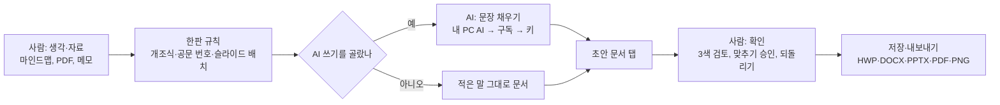

# 한판 프로젝트 이해

> 기준일 2026-11-13 · 기준 코드 한판 0.20.0(main 병합, 공개 게시 준비 중) · AI 포토·AI 일러스트 웹판 photo-v0.20.2-h8, illust-v0.21.0-h8
> 읽는 사람: 대표님, 온라인 교육 콘텐츠 제작자. 버튼 하나하나의 따라 하기는 사용설명서(앱 안 F1)에 있다.

---

## 1. 한 문장 요약

**한판은 한국 사무실에서 보고서·공문·발표자료·홍보물을 만드는 사람이, 생각 정리(마인드맵)부터 한글·워드·PPT·디자인까지 한 프로그램 안에서 이어 만들고, AI를 복사·붙여넣기 없이 문서 안에서 바로 쓰게 해 주는 무료 데스크톱 오피스다.**

- 누구의: 공공기관·학교·기업의 문서 담당자(실무자)
- 어떤 일을: 정리 → 작성 → 양식 맞추기 → 발표자료 → 홍보물
- 어떻게 쉽게: 한 창의 탭으로 잇고, AI는 내 PC에 깔린 것이나 이미 쓰는 구독을 그대로 연결한다

---

## 2. 먼저 알아야 할 업무 지식

결론: 한국 사무실의 문서 일은 "정해진 양식에 맞춰, 여러 사람의 검토를 거쳐, 여러 프로그램을 오가며" 만든다. 한판의 기능은 모두 이 현실에 맞춰져 있다.

### 2-1. 사무실 문서 프로그램 지도

결론: 공공은 한글(HWP), 기업은 MS 오피스가 기본이고, 최종본은 PDF로 돌린다. 한 사람이 하루에 서너 개 프로그램을 오간다.

| 프로그램 | 주로 쓰는 곳 | 대표 문서 | 파일 이름 끝(확장자) |
|---|---|---|---|
| 한글(한컴오피스) | 중앙부처·지자체·공공기관·학교·군 | 공문, 개조식 보고서, 계획서, 가정통신문 | .hwp(옛 형식), .hwpx(새 형식) |
| 워드(MS 오피스) | 기업, 외국계, 법무·계약 | 기획서, 계약서, 회의록 | .docx |
| 엑셀 | 공공·기업 모두 | 견적서, 예산표, 정산표, 명단 | .xlsx |
| 파워포인트 | 공공·기업 모두 | 발표자료, 제안서, 교육자료 | .pptx |
| PDF | 모든 곳의 최종본 | 결재 끝난 문서, 제출본, 매뉴얼 | .pdf |
| 마인드맵(XMind 등) | 기획 초기, 회의 정리 | 생각 지도 | .xmind |

- **확장자**: 파일 이름 끝의 점 뒤 글자. 어떤 프로그램이 그 파일을 여는지 정한다.
- **HWPX**: 한컴이 공개한 새 한글 형식. 공공에서는 다른 프로그램도 읽을 수 있는 개방형 형식(HWPX·PDF)을 쓰는 흐름이 늘고 있다.
- 실제 모습: 구청 주무관은 한글로 공문을 쓰고, 엑셀로 예산을 붙이고, PPT로 설명회 자료를 만들고, PDF로 바꿔 결재 시스템에 올린다. 같은 내용을 세 번 옮겨 적는다.

### 2-2. 문서를 만드는 사람들과 주고받는 것

결론: 문서 하나에 최소 세 사람이 닿는다. 작성자는 "빨리 초안", 검토자는 "형식과 숫자", 결재권자는 "한눈에 결론"을 원한다.

| 역할 | 누구 | 책임 | 하루에 하는 일 | 주고받는 것 |
|---|---|---|---|---|
| 작성자(실무자) | 주무관, 사원·대리 | 초안 작성, 자료 모으기 | 보고서·공문 초안, 숫자 확인, 양식 맞추기 | 초안을 위로 올리고, 고칠 곳을 받는다 |
| 검토자 | 팀장, 과장 | 형식·숫자·표현 확인 | 빨간펜 검토, "결론부터 다시" 지시 | 고칠 곳을 내려보낸다 |
| 결재권자 | 국장, 부서장, 대표 | 승인과 책임 | 1쪽 요약을 보고 판단 | 승인 또는 반려 |
| 받는 쪽 | 다른 기관, 고객, 청중 | 내용을 받아 처리 | 공문 접수, 견적 비교, 발표 청취 | 회신, 계약, 질문 |

- **기안**: 결재를 받으려고 처음 올리는 문서. **결재**: 권한 있는 사람이 승인하는 일. **반려**: 고쳐 오라고 돌려보내는 일.
- 공공은 전자결재 시스템(중앙부처·지자체의 온나라, 학교의 K-에듀파인 등)에 한글 문서를 올린다. 그래서 "한글로 깨지지 않게 만드는 것"이 실무에서 가장 중요하다.

### 2-3. 문서 종류별 만드는 순서

결론: 문서마다 순서가 정해져 있고, 가장 오래 걸리는 단계는 "쓰기"가 아니라 "정리"와 "양식 맞추기"다.

**보고서(개조식)** — 윗사람이 1~2쪽 안에서 판단하게 만드는 문서
1. 무엇을 보고할지 정리한다(현황, 문제, 대책, 건의).
2. 양식을 연다(부서 양식, 지난번 보고서 복사본).
3. 개조식으로 쓴다. 예: `□ 시설 점검 결과` 아래 `○ 승강기 12대 중 2대 부품 교체 필요함`
4. 숫자·날짜를 확인하고 팀장 검토 → 고치기 → 결재.

**개조식 규칙**(한국 공공 보고서의 관행)

| 기호·표기 | 뜻 | 예 |
|---|---|---|
| □ → ○ → ― → · | 큰 항목에서 작은 항목으로 | □ 추진 배경 / ○ 민원 30% 증가 |
| ※ | 참고·주석 | ※ 2026. 10. 기준 |
| "~함, ~임" 어미 | 짧게 끊는 문장 | 예산 확보 필요함 |
| Ⅰ. Ⅱ. | 장 나누기(긴 보고서) | Ⅰ. 현황 Ⅱ. 대책 |

**공문** — 기관끼리 주고받는 공식 문서
- 항목 번호 순서: `1.` → `가.` → `1)` → `가)` → `(1)` → `(가)`
- 날짜는 `2026. 5. 8.`, 시각은 24시각제 `14:30`, 본문 끝에 `끝.`을 붙인다.
- 수신, 제목, 본문, 붙임, 발신 명의 순서로 놓는다.

**기획서** — "왜, 무엇을, 어떻게, 얼마에, 언제까지"를 설득하는 문서. 배경 → 목표 → 추진 내용 → 일정 → 예산 → 기대 효과 순서로 쓴다. 마인드맵으로 뼈대를 먼저 잡으면 빨라진다.

**견적서** — 물건·서비스 값을 미리 알려 주는 문서. 엑셀로 많이 만든다.

| 품목 | 수량 | 단가 | 공급가액 |
|---|---|---|---|
| 교육 콘텐츠 제작 | 1식 | 1,000,000원 | 1,000,000원 |
| 부가가치세(10%) | | | 100,000원 |
| 합계 | | | 1,100,000원 |

- **공급가액**: 세금 빼기 전 값. **부가가치세**: 공급가액의 10%. **유효기간**: 이 값이 유지되는 기간(예: 발행일로부터 30일).

**발표자료** — 보고서 내용을 청중 앞에서 말하기 좋게 바꾼 것. 한 장에 메시지 하나, 결론 먼저, 숫자는 크게. 대개 보고서를 다 쓴 뒤 PPT로 "다시 옮겨" 만든다.

### 2-4. 양식 문화

결론: 한국 사무실은 "빈 종이에서 쓰지 않는다". 정해진 양식과 지난번 파일을 복사해 고치는 것이 기본이다.

- **기관 양식**: 부서마다 보고서·공문 틀이 있다. 글꼴까지 정해 둔 곳이 많다(제목 HY헤드라인M, 본문 휴먼명조, 기본 함초롬바탕).
- **법령 서식**: 법에 붙은 공식 서식. "별지 제○호 서식"이라고 부르고, 국가법령정보센터(law.go.kr)에 원본이 있다. 예: 정보공개 청구서. 법이 바뀌면 서식도 바뀐다.
- **회사 템플릿**: 기업은 회사 로고·색이 들어간 PPT·워드 틀을 쓴다.
- **복사해서 고치기**: "작년 이맘때 보고서"를 열어 숫자와 날짜만 바꾼다. 빠르지만 지난해 숫자가 남는 실수가 잦다.
- 비유: 양식은 "주문서 칸이 정해진 식당"이다. 칸을 지키면 주방(검토자)이 빨리 알아보고, 칸을 벗어나면 다시 쓰라고 돌아온다.

### 2-5. 지금 사람들이 AI를 문서 일에 쓰는 방식

결론: 대부분 "AI 웹사이트에 붙여넣고, 답을 복사해 한글에 다시 붙여넣는" 방식이다. 옮길 때마다 서식이 깨지고, 문서가 회사 밖으로 나간다.

지금의 순서(실제 예: 주간 업무 보고)
1. 메모장에 이번 주 한 일을 적는다.
2. ChatGPT나 Claude 웹사이트를 열고 "개조식 보고서로 써 줘"와 함께 붙여넣는다.
3. 답을 복사해 한글 양식에 붙여넣는다.
4. 글머리 기호, 글꼴, 줄 간격이 깨져 손으로 다시 맞춘다.
5. AI가 지어낸 숫자가 없는지 하나씩 대조한다.
6. 같은 내용으로 PPT를 만들려면 2~5를 다시 한다.

| 불편 | 왜 생기나 | 손해 |
|---|---|---|
| 서식 깨짐 | 웹 답은 서식 없는 글이다 | 맞추는 데 다시 시간 |
| 개조식이 아님 | AI가 한국 공문 관행을 모른다 | "~합니다" 문장을 손으로 고침 |
| 숫자 지어냄 | AI는 그럴듯한 말을 만든다(환각) | 틀린 숫자가 보고서에 들어갈 위험 |
| 보안 | 내부 문서가 AI 회사 서버로 간다 | 공공·기업은 금지하는 곳이 많다 |
| 반복 | 문서 종류마다 처음부터 | 같은 일을 세 번 |

- **환각**: AI가 사실이 아닌 내용을 사실처럼 말하는 현상.

### 2-6. AI를 쓰는 네 가지 길: 구독, API 키, 무료 한도, 내 PC AI

결론: AI를 쓰는 값은 "월 정액", "쓴 만큼", "무료 한도", "내 PC에서 공짜" 네 가지다. 한판은 넷 다 연결하되, 사람이 고르지 않은 유료 길로 스스로 넘어가지 않는다.

| 길 | 무엇 | 돈 | 문서가 밖으로 나가나 | 비유 |
|---|---|---|---|---|
| 구독 | ChatGPT·Claude의 월 요금제 | 월 정액(개인 기본 요금제는 월 20달러 안팎, 공개 요금 기준·바뀔 수 있음) | 그 회사로 간다 | 뷔페 정액권 |
| API 키 | AI 회사가 발급하는 이용 열쇠(긴 문자열) | 쓴 만큼 | 그 회사로 간다 | 법인카드 번호 |
| 무료 한도 | OpenRouter, Google Gemini 무료 | 하루 한도 안에서 무료 | 그 회사로 간다, 학습에 쓰일 수 있음 | 시식 코너 |
| 내 PC AI | 내 컴퓨터에서 도는 AI 모델 | 없음(PC 성능이 필요) | 안 나간다 | 집에서 해 먹는 밥 |

- **API**: 프로그램끼리 서로 기능을 빌려 쓰는 약속된 창구. **API 키**는 그 창구를 쓰는 열쇠다. 키가 새면 남이 내 돈으로 AI를 쓴다. 그래서 한판은 키를 PC에만 두고, Windows에서는 보안키(USB)로 한 번 더 잠근다.
- **토큰**: AI가 글을 세는 단위. 쓴 만큼 요금은 토큰 수로 매긴다.
- **내 PC AI**: Ollama, LM Studio 같은 프로그램으로 한국어 모델(예: EXAONE, Qwen)을 받아 PC에서 돌린다. 예: `ollama pull exaone3.5:7.8b`.

### 2-7. 오픈소스와 라이선스

결론: 오픈소스는 "설계도를 공개해 누구나 고쳐 쓰게 한 프로그램"이다. 공짜로 쓰는 대신 지켜야 할 조건(라이선스)이 있고, 이름(상표)은 함께 오지 않는다.

- 비유: 공개된 요리 레시피. 레시피(코드)는 고쳐서 팔아도 되지만, 원래 식당의 간판(상표)을 내 가게에 달면 안 되고, 레시피 출처는 메뉴판(고지)에 적어야 한다.
- **포크**: 남의 오픈소스를 통째로 복사해 따로 고쳐 가는 것. 한판의 계보는 GenOffice → 이음오피스(한 교사가 자기 업무용으로 고친 포크) → 한판이다.

| 라이선스 | 어디에 쓰였나 | 허용 | 지킬 것 |
|---|---|---|---|
| Apache-2.0 | 한판 본체(GenOffice·이음오피스) | 고쳐서 배포·판매 | LICENSE·NOTICE 동봉, 고친 사실 표시, 상표 사용 불가 |
| MIT | 한글 편집 화면(rhwp), 그래픽 앱 | 거의 모든 사용 | 저작권 고지 유지 |
| SIL OFL | 무료 글꼴 | 문서에 넣기, 앱에 싣기 | 글꼴 파일 자체 판매 불가 |
| 공공누리 제1유형 | 지자체·기관 글꼴 | 상업 이용 포함 | 출처 표시 |
| 저작권 만료 | 옛 그림(공유마당) | 자유 이용 | 출처 표시 권장 |

- **저작권과 상표는 다르다**: 저작권은 코드·글·그림을, 상표는 이름·로고를 지킨다. 그래서 "이음오피스를 바탕으로 TEN AI가 만든 한판"은 맞고, "자체 개발 오피스"는 사실과 다르다.

---

## 3. 이 프로젝트가 푸는 문제

결론: 문서 일의 손해는 "옮기기·서식 맞추기·보안 걱정" 세 곳에서 난다. 한판은 이 셋을 한 창 안에서 없애는 것을 목표로 한다.

| 업무 단계 | 힘든 점 | 지금 처리 방식 | 손해 | 한판의 답 |
|---|---|---|---|---|
| 생각 정리 → 문서 | 마인드맵 내용을 한글로 옮김 | 손으로 다시 타이핑 | 같은 내용 두 번 입력 | 마인드맵 보내기(한글·워드·PPT·카드뉴스) |
| AI로 초안 | 웹 AI에 붙여넣기 | 복사·붙여넣기 반복 | 서식 깨짐, 개조식 아님 | 문서 탭 안 AI 도우미, AI가 살 붙이기 |
| 양식 맞추기 | 공문 번호·날짜·끝. 표기 | 눈으로 점검 | 검토에서 반려 | 공문 정돈·공문 점검, 한판 양식 |
| 보고서 → 발표 | 같은 내용을 PPT로 | 처음부터 다시 | 반나절 | PPT로 보내기 + 스타일 10가지 |
| 홍보물 | 디자인 프로그램을 따로 배움 | 외주 또는 포기 | 비용, 시간 | AI 디자인, AI 포토, AI 일러스트 |
| 보안 | 내부 문서가 밖으로 | AI 사용 금지 | AI 효과 못 누림 | 내 PC AI 우선 |
| 비용 | 오피스·AI 각각 유료 | 라이선스 구매 | 고정비 | 한판 무료, AI는 가진 것 연결 |

- 예시(추정, 측정 아님): 주간 보고 한 건을 "메모 → 한글 보고서 → PPT"로 만들 때, 옮기기와 서식 맞추기에만 30분 이상이 든다는 것이 현장의 흔한 말이다. 한판으로 줄어드는 시간은 아직 측정하지 않았다.

---

## 4. 기능 전체

결론: 한판의 기능은 18묶음 103가지다(0.20.0 코드 기준, 앱 목록·메뉴·설정 화면 대조). 앱 목록은 홈의 **모든 앱** 4묶음 15가지이고, 그 밖에 처음 실행·홈·공통 기능과 설정이 있다.

읽는 법: 표마다 "언제·무엇을 넣으면 → 무엇이 나오고 무엇이 좋아지나 → 주의할 점"이다. "누가"는 묶음 제목에 적었다. 굵은 이름은 한판이 더했거나 크게 바꾼 것이다.

**모든 앱 목록(홈 › 새로 만들기 › 모든 앱)**

| 묶음 | 앱 |
|---|---|
| 문서 만들기 | 마인드맵, AI 한글, AI 파워포인트, AI 워드, AI 엑셀, AI 마크다운, AI 웹 문서, 한판 양식 |
| PDF · 변환 | AI PDF, PDF 도구, 마크다운 변환기 |
| 그림 | AI 포토, AI 일러스트, AI 디자인 |
| 파일 | 로컬 파일 열기 |

화면 언어가 한국어가 아니면 AI 한글·한판 양식·AI 디자인은 숨는다(설정 › 일반 › 한국 문서 기능으로 켬). 전자책(EPUB) 편집기는 앱 목록에 없고 .epub 파일을 열면 뜬다.

### 4-1. 처음 실행 (누가: 설치하는 모든 사람, Windows 기준)

| 번호·기능 | 언제·무엇을 넣으면 | 나오는 것·좋아지는 점 | 주의 |
|---|---|---|---|
| F01 **설치 화면 사용권·면책 안내** | 설치 파일 실행 | 무료 오픈소스, 있는 그대로 제공, 사용자 책임, 보내는 정보 6개 항목 | TEN AI의 고의로 생긴 손해는 예외 |
| F02 **첫 실행 이용 조건 동의** | 처음 켤 때 | 4개 항목을 읽고 "동의하고 계속" | 문구가 바뀌면 다시 묻는다 |
| F03 **보안키 만들기** | 동의 다음 | "USB에 만들기(권장)" 또는 "이 PC에 만들기" | PC 보관은 위험 동의가 따로 필요 |
| F04 **보안키 확인·잠금** | 켤 때마다, USB를 뺄 때 | USB가 있어야 열리고, 빼면 창마다 잠김 덮개 | Mac·Linux에는 없다 |
| F05 처음 안내 | 보안키 다음 | 환영 → AI 연결 → 준비 끝 3단계 | 건너뛰어도 설정 › AI에서 연결 |

### 4-2. 홈 (누가: 모든 사용자, 매일 아침 첫 화면)

| 번호·기능 | 언제·무엇을 넣으면 | 나오는 것·좋아지는 점 | 주의 |
|---|---|---|---|
| F06 **홈 보드** | 앱을 켜면 | 카드를 늘어놓은 첫 화면 | 왼쪽 메뉴 맨 위 "홈"으로 언제든 복귀 |
| F07 **시작 카드** | 주제를 적고 "마인드맵 만들기" | 그 주제가 가운데인 새 마인드맵. 예시 3개(시설 점검 결과 보고, 입주사 안내문, 주간 업무 보고) | 사용 설명서 단추도 여기 |
| F08 **트렌드 레이더 · 오늘의 기상도** | 켜면 자동으로 받음 | 10개 분야의 오늘 날씨와 "오늘의 한 줄" | 인터넷이 없으면 마지막 받은 날짜로 표시 |
| F09 **AI 브리핑** | 기상도에서 형식 고르기 | Word·한글(HWP)·마인드맵·PowerPoint·PDF 새 문서로 브리핑 | 재료에 없는 숫자는 다시 쓰게 하고 남으면 뺀다 |
| F10 새로 만들기 · 모든 앱 | 앱 아이콘 누르기 | 새 문서. 모든 앱에서 이름·하는 일로 찾기, 최근에 쓴 앱 3개, 핀 고정, 새 앱 표시 | |
| F11 이어서 하기 | 최근 문서 누르기 | 바로 열림, "전체 N개"로 최근 사용 화면 | |
| F12 빠른 메모 | 카드에 적기 | 이 PC에만 저장되는 메모 | |
| F13 즐겨찾기 | 파일에 별표 | 즐겨찾기 카드·화면에 모임, 그룹으로 묶기 | AI 질문의 자료가 된다 |
| F14 카드 추가 | 홈 꾸미기 › 카드 추가 | 폴더 보기, 시계·날짜, 바로가기, 뺀 카드 다시 넣기 | 24장까지 |
| F15 **홈 꾸미기** | "홈 꾸미기" | 끌어 옮기기, 크기 바꾸기, 기본 배치로, 목록으로 정리(키보드로) | 직접 더한 카드는 기본 배치로에도 남음 |
| F16 파일 검색 | 맨 위 검색 칸 | 이름과 내용으로 찾은 결과 | 찾기용 색인은 PC 안에만 |
| F17 최근 사용 · 즐겨찾기 화면, 폴더 | 왼쪽 메뉴 | 표로 거르기·옮기기·지우기, 홈에 폴더 추가·새 폴더 | 지우기는 실제 파일에 닿는다 |
| F18 AI 질문 | 질문 적기 | 즐겨찾기 파일을 찾아 읽고 출처와 함께 답, 마크다운·Word로 저장 | 그룹으로 범위를 좁힐 수 있음 |
| F19 AI 폴더 작업 | 폴더와 Claude Code·Codex 고르기 | AI가 폴더 속 파일을 직접 읽고 고침(새 창) | 고급 기능, 명령마다 허락을 묻는 것이 기본 |
| F20 Google 드라이브 | 설정 › 연동에서 연결 | 드라이브 파일을 탭으로 | 한판 배포판에는 연결 정보가 없어 나오지 않는다 |

### 4-3. 모든 편집기 공통 (누가: 문서를 여는 모든 사람)

| 번호·기능 | 언제·무엇을 넣으면 | 나오는 것·좋아지는 점 | 주의 |
|---|---|---|---|
| F21 탭과 탭 메뉴 | 탭을 오른쪽 단추로 | 저장, 다른 이름으로 저장, 인쇄, 이름 바꾸기, 복사본 만들기, 경로·파일 이름 복사, 폴더에서 보기, 기본 앱으로 열기, 탭 옮기기·닫기, 닫힌 탭 다시 열기 | |
| F22 화면 나누기 | 오른쪽에·아래에 나누기, 새 창으로 떼기 | 두 문서를 나란히 | |
| F23 **공유하기** | 탭 메뉴 › 공유하기 | Windows 공유 창(메일·메신저로 보내기) | 저장한 뒤에만 |
| F24 **다른 앱으로 보내기** | 파일 메뉴 | 지금 문서를 마크다운을 거쳐 다른 앱의 새 문서로. "마크다운으로 먼저 보고 고치기" 가능 | PPT로는 100장까지, 원본은 그대로 |
| F25 이 문서로 새 문서 만들기 · 자료 보기 | 파일 메뉴 | 자료를 읽어 PPT·HTML·마인드맵을 AI가 새로 만듦. 어떤 자료로 만들었는지 "자료 보기"·"이 문서로 만든 문서" | 자료 20개, 하나에 50MB까지 |
| F26 **내 양식으로 저장** | 탭 메뉴 | 지금 문서를 한판 양식의 "내 양식"에 등록 | |
| F27 내보내기 | 파일 메뉴 | 편집기에 따라 PDF·이미지·단일 HTML·Word·ODT·PowerPoint·Excel·Markdown·EPUB | |
| F28 AI 도우미(AI 패널) | 패널에 말로 부탁 | AI가 앱의 편집 도구로 문서를 직접 고침, 바뀐 곳 표시, 되돌리기, 파일 첨부, `@`로 다른 문서 붙이기 | 연결한 AI를 씀, 유료로 스스로 안 바꿈 |
| F29 스킬 | 입력 칸에 `/` | 작업 설명서를 불러 같은 일을 같은 방식으로(기본 5개: 회의록 정리, 공지 쓰기 등) | 일반 AI 창에서는 스크립트가 돌지 않음 |
| F30 가리기 | 문서 일부 표시 | 그 부분은 어떤 AI에도 가지 않음 | 워드 편집기에는 없음 |
| F31 자동 저장 · 복구 | 설정에서 켬, 갑자기 꺼진 뒤 | 다시 켜면 열려 있던 문서 복구 목록 | |
| F32 사용 설명서 | F1 | 앱 안 설명서, "한판 시작하기" | |

### 4-4. 마인드맵 (누가: 기획·보고를 시작하는 사람, 일의 출발점)

| 번호·기능 | 언제·무엇을 넣으면 | 나오는 것·좋아지는 점 | 주의 |
|---|---|---|---|
| F33 마인드맵 편집 | 위쪽 띠 5개 탭(홈·삽입·서식·스타일·보기) | 하위·같은 단계 토픽, 관계선, 요약, 배치 6가지, 테마 | .xmind 파일 그대로 저장 |
| F34 찾기·바꾸기 | Ctrl+F, Ctrl+H | 모든 시트의 토픽 제목(메모·라벨 포함 선택) | 모두 바꾸기는 시트마다 되돌리기 한 번 |
| F35 꾸미기 도구 | 삽입·스타일·홈·보기 탭 | 그림(10MB), 아이콘(우선순위·진행률·깃발 등), 테두리, 서식 복사, 가나다 정렬, 단계별 보기, 보이기 | 감춘 것은 파일에서 지워지지 않음 |
| F36 **한글 보고서로 보내기** | 보내기 › 양식·글꼴·부서·작성자 | 개조식·장 나눈 보고서·공문 번호 .hwpx가 새 탭에. "AI가 문장으로 살 붙이기" 선택 | 저장 위치는 처음 저장할 때 묻는다 |
| F37 **PPT로 보내기** | 보내기 › 슬라이드 스타일 10가지 | 표지·목차·가지마다 한 장·마무리. "AI가 스타일에 맞춰 슬라이드 글 쓰기"로 제목·핵심 한 줄·발표자 노트 | 마인드맵에 없는 숫자는 짓지 않음 |
| F38 **워드 보고서로 보내기** | 보내기 | .docx 보고서 | 맞추기는 안 됨 |
| F39 **카드뉴스로 보내기** | 보내기 | 표지 한 장 + 큰 가지마다 카드 한 장(AI 디자인) | |
| F40 **연결된 문서와 맞추기** | 보내기 › 맞추기 | 마인드맵↔한글 문서의 바뀐 곳, 양쪽에서 다르게 고친 곳은 고르기 | 한글만 된다, 본문은 덮어쓰지 않음 |
| F41 **그림 출처 점검** | 보내기 › 그림 출처 점검 | 그림 붙은 토픽에 출처 메모가 있는지 | |
| F42 발표 · 내보내기 | 보기 › 발표, 파일 메뉴 | 지도로 발표, PNG·마크다운 개요·PDF | |

### 4-5. AI 한글 (누가: 공문·보고서 담당 공무원·교사·실무자)

| 번호·기능 | 언제·무엇을 넣으면 | 나오는 것·좋아지는 점 | 주의 |
|---|---|---|---|
| F43 한글 편집 | .hwp·.hwpx 열기, 새로 만들기 | 한글 문서를 열고 고쳐 저장 | 한컴 글꼴이 없으면 화면에 대체 글꼴 |
| F44 **공문 정돈** | 한판 도구 › 공문 정돈 | 날짜 `2026. 5. 8.`, 시각 `14:30`, 끝에 ` 끝.` | AI 없이 PC 안에서 처리 |
| F45 **공문 점검** | 한판 도구 › 공문 점검 | 수신·제목, 끝 표시, 날짜 표기, 항목 번호 차례, 어미 섞임 알림 | |
| F46 **세대별 톤 바꾸기** | 60대·40대·MZ 고르기 | 어미가 바뀐 문장 | 규칙 기반, 표 칸 안은 안 바꿈 |
| F47 **3색 검토 표시** | 한판 도구 | 빨강(사실 확인 필요), 파랑(핵심), 노랑(숫자·날짜·금액) 형광펜 | 검토 전 자기 점검용 |
| F48 **역관목조분 프롬프트** | 역할·관련분야·목적·조건·분량 칸 채우기 | 잘 짜인 AI 요청문 복사 | 다른 AI 창에 붙여 써도 된다 |
| F49 **그림 출처 점검** | 한판 도구 | 출처 없는 그림, 목록에 빠진 그림 알림, [목록에 넣기] | |
| F50 **공유마당 그림 넣기(AI)** | AI 도우미에 "씨름 그림 찾아 넣어 줘" | 저작권 만료 그림과 출처 줄을 한판이 적음 | 공유마당 키 필요(설정 › 연동) |

### 4-6. 한판 양식 (누가: 빈 종이에서 시작하기 싫은 모든 사람)

| 번호·기능 | 언제·무엇을 넣으면 | 나오는 것·좋아지는 점 | 주의 |
|---|---|---|---|
| F51 **한판 양식 22가지** | 홈 › 한판 양식 › 한글로·워드로·마인드맵으로 열기 | 공문 3, 보고서 5, 제안서 2, 회의록·메모 2, 사업기획 4, 교육 3, 콘텐츠 3 | ○○○ 자리를 채운다 |
| F52 **법령 서식 4가지** | 한글로 열기 | 정보공개 청구서, 행정심판 청구서, 위임장(민원), 거부처분 이의신청서 원본 사본 | 내기 전 law.go.kr 최신판 확인 |
| F53 **내 양식** | 내 양식 추가, 내 양식으로 저장 | 우리 부서 양식을 목록에 두고 꺼내 쓰기 | |

### 4-7. AI 워드 · AI 엑셀 · AI 파워포인트 · AI 마크다운 · AI 웹 문서 (누가: 기업 실무자, 발표 담당)

| 번호·기능 | 언제·무엇을 넣으면 | 나오는 것·좋아지는 점 | 주의 |
|---|---|---|---|
| F54 AI 워드 | .docx 열기·새로 만들기, AI에 부탁 | 보고서·기안문 편집, AI 수정은 변경 내용 표시로 검토 | 작성자 이름은 설정 › 일반 |
| F55 AI 엑셀 | .xlsx, AI에 부탁 | 표·계산·차트 편집, 첨부한 통합 문서 합치기 | 저장 안 한 첨부는 거절 |
| F56 AI 파워포인트 | .pptx, "발표 자료 만들어 줘" | 말로 만드는 슬라이드, 디자인 템플릿, 편집 | AI 이미지 생성은 이미지 제공업체가 있어야 |
| F57 **효과음 6가지** | 삽입 › 효과음 | 국악 효과음(축하, 산뜻함, 궁금함, 벅차오름, 개운함, 깔끔한 마무리) | CC BY 출처가 소리 이름에 붙음 |
| F58 AI 마크다운 | .md 쓰기 | 가볍게 쓰는 글, AI가 쓴 글 받기 좋은 형식 | |
| F59 AI 웹 문서 | .html, "안내 페이지 만들어 줘" | 안내 페이지, 단일 파일 HTML 내보내기 | |

### 4-8. PDF (누가: 받은 PDF를 읽고 고치고 바꾸는 사람)

| 번호·기능 | 언제·무엇을 넣으면 | 나오는 것·좋아지는 점 | 주의 |
|---|---|---|---|
| F60 AI PDF 편집 | PDF 열기 | 메모, 가리기(내용을 지운 사본), 글 넣기, 쪽 위 글자 고치기, 양식 채우기, 인증서 서명 | 서명본은 새 파일로 |
| F61 PDF 변환 | 변환 메뉴 | Word·Excel·PowerPoint·Markdown·EPUB 파일 | PC 안에서 처리 |
| F62 AI로 페이지 읽기 | 스캔한 쪽 고르고 시작 | AI가 쪽 그림을 읽어 글·표·수식을 보관 | 쪽 그림이 AI로 간다 |
| F63 문서 번역 · 번역 나란히 | 언어·형식 고르고 시작 | 번역 PDF·Markdown·EPUB, 쪽 옆에 번역 나란히 | 긴 작업, 멈춘 번역은 이어 하기 |
| F64 AI 핵심 표시 | 분류(연구·보고서, 계약서·약관 등) 고르기 | 핵심 문장 형광펜 제안, 받아들인 것만 칠함 | |
| F65 AI 설명·번역·개요 | 문장 고르고 E·T, 개요 만들기 | 구절 설명·번역, 세 줄 요약·핵심 용어, 추천 질문 | |
| F66 PDF 노트 | 노트 열기 | 이 PDF와 이어진 마크다운 노트에 내용 넣기 | PDF를 먼저 저장 |
| F67 PDF 도구 | 홈 › PDF 도구 | PDF 합치기·나누기·용량 줄이기 | |
| F68 **마크다운 변환기** | 마크다운 붙여넣기 → 형식·모양 고르기 → 한 번에 변환 | HWP·HWPX·Word·ODT·PDF·HTML을 같은 이름으로 한꺼번에 | 같은 이름이 있으면 (2) 붙임 |
| F69 전자책(EPUB) | .epub 열기 | 책 읽기, 본문 고치기, 책 번역 | DRM 걸린 책은 안 열림 |

### 4-9. AI 디자인 (누가: 포스터·카드뉴스·안내문을 만드는 사람)

| 번호·기능 | 언제·무엇을 넣으면 | 나오는 것·좋아지는 점 | 주의 |
|---|---|---|---|
| F70 **템플릿** | 템플릿 탭 | 20가지(공공기관 안내문, 가정통신문, 행사 포스터, 카드뉴스 표지, 유튜브 썸네일, 상장, 메뉴판, 안전 수칙 등), 빈 판형, 개요로 카드뉴스 | 한판 글꼴이라 어느 PC나 같은 모양 |
| F71 **요소** | 요소 탭 | 도형 11가지, 펜·형광펜, 아이콘 124개, 그림 넣기(15MB), QR 코드 | 아이콘은 Lucide(ISC) |
| F72 **글자** | 글자 탭 | 제목·부제·본문, 강조 배지·외곽선·그림자 제목·인용구 | |
| F73 **레이어** | 레이어 탭 | 요소 목록, 앞뒤 순서, 자물쇠 | |
| F74 **판 위 편집** | 끌기·손잡이·두 번 누르기 | 맞춤선, 회전, 사진 자르기, 그룹(Ctrl+G), 눈금자, 필터, 그림자 | |
| F75 **크기 바꾸기** | 위쪽 단추 | 판형을 바꿔도 배치 유지 | 되돌리기 가능 |
| F76 **AI 도우미 · 새로 만들기** | "11월 20일 저녁 7시 본관 강당 학부모 설명회 안내문" | 판형·분위기에 맞춘 새 디자인 | AI는 글만, 배치·색은 한판이 정함 |
| F77 **이 디자인에 글 채우기** | 템플릿 고른 뒤 내용 적기 | 배치·색은 두고 글만 바꿈 | 잠근 상자는 안 바꿈 |
| F78 **✦ 막대로 고치기** | 글 상자 고르기 | 다듬기, 짧게, 눈길 끌게, 영↔한 번역 | |
| F79 **공유마당 그림 · 출처 목록** | 요소 › 공유마당에서 찾기 | 옛 그림 넣기, 출처 줄 자동, 내보낼 때 출처 목록 | 하루 1,000번 검색 |
| F80 **내보내기** | 위쪽 단추 | 문서에 붙여 넣기용 복사, PNG, JPG, PDF, 디자인 파일(.hpdesign) | |
| F81 **글꼴** | 글꼴 목록 | 한판 글꼴, 공유마당 무료 글꼴 7종, PC 글꼴, 글꼴 파일 추가(10MB) | 한 굵기 글꼴은 "굵게"가 붙은 것을 고른다 |

### 4-10. AI 포토 · AI 일러스트 (누가: 사진 보정·로고 작업이 필요한 사람)

| 번호·기능 | 언제·무엇을 넣으면 | 나오는 것·좋아지는 점 | 주의 |
|---|---|---|---|
| F82 **AI 포토 편집** | PSD·PNG·JPG 열기 | 레이어 사진 편집, 이 PC의 글꼴 사용 | 레이어가 있으면 PSD로 저장, 그래픽 가속 필요 |
| F83 **배경 지우기** | 단추 | 배경이 지워진 사진 | 그림 레이어를 골라야 함 |
| F84 **자동 보정** | 단추 | 색과 밝기 자동 맞춤 | |
| F85 **크기 맞춰 내보내기** | 너비·높이·인쇄용(300dpi)·JPG 품질 | 원하는 크기의 사본 | 원본은 그대로 |
| F86 **AI 도우미(포토)** | "배경 지워 줘", "밝기를 조금 올려 줘" | AI가 앱의 명령으로 고침, 요청 하나를 되돌리기 한 번으로 | AI가 일하는 동안 편집 잠김 |
| F87 **AI 일러스트 편집** | SVG·AI 열기 | 벡터 그림·로고 편집 | |
| F88 **그림 따라 그리기** | 넣은 그림 고르고 단추 | 그림을 도형(벡터)으로 바꿈 | |
| F89 **가운데 정렬** | 단추 | 대지 가운데로 | |
| F90 **PNG·SVG 내보내기** | 단추 | 그림·벡터 사본 | |
| F91 **일러스트레이터용 .ai로 보내기** | 단추 | 다른 디자인 프로그램에서 여는 .ai 사본 | |
| F92 **AI 도우미(일러스트)** | "가운데에 둥근 사각형 그려 줘" | 명령으로 그리고 되돌리기 한 번 | |
| F93 **인쇄** | 인쇄 | 방향 고르고 인쇄 | |

### 4-11. 설정 (누가: 모든 사용자, 처음 한 번과 바꿀 때)

| 번호·기능 | 어디 | 들어 있는 것 | 주의 |
|---|---|---|---|
| F94 계정 | 설정 › 계정 | 지금 연결된 구독 요약 | |
| F95 AI 연결 | 설정 › AI | 사용할 AI(자동·직접), 구독 연결(Claude·ChatGPT·Codex: 설치·로그인), 무료로 쓰기(OpenRouter·Gemini), 로컬 AI(서버 추가·모델·연결 테스트), AI 개인정보 안내 | 사람이 고르면 한판이 다시 안 바꿈 |
| F96 AI 고급 › 모델 | 설정 › AI › 고급 | API 키 제공업체, 서버 주소, 엔드포인트 여러 개, 연결 테스트, 출력 토큰 상한 | 키는 이 PC에만 |
| F97 AI 고급 › 미디어·검색 | 설정 › AI › 고급 | 이미지 생성·이미지 분석·동영상 분석·웹 검색·로컬 파일 검색, AI가 인터넷 도구 쓰기, 검색 결과 다시 정렬, 자동 호출에 구독 사용 | 다시 정렬·자동 호출은 기본 꺼짐 |
| F98 스킬 | 설정 › 스킬 | 켜기·끄기, 가져오기(폴더·zip·깃허브), 내 스킬 고치기 | |
| F99 일반 | 설정 › 일반 | 언어(21개), 처음 안내 다시 보기, 한국 문서 기능, 테마, 문서 페이지 테마, AI 패널 위치·글자 크기·맞춤법·시작, 사용자 이름, Office 문서 기본 앱, 저장 위치, 자동 저장, 탐색기에서 Space로 미리 보기, AI 결과 보관소 | |
| F100 **보안키** | 설정 › 일반의 보안키 카드 | 있는 곳, 만든 날, 등록한 USB 수, 예비 USB 만들기, USB로·이 PC로 옮기기, 새 보안키 만들기 | 새로 만들면 넣어 둔 API 키는 지워짐 |
| F101 연동 | 설정 › 연동 | 공유마당 그림 키, 개발자용(AI 코딩 도구에서 한판 쓰기: 명령줄·MCP 서버) | |
| F102 정보 | 설정 › 정보 | 버전, 업데이트 채널(안정·베타), 사용권 및 면책 안내, 오픈소스 라이선스, 상표·저작권 문의, 의견 보내기, 한글 공개 문서 참고 문구 | |
| F103 업데이트 | 켤 때와 그 뒤 | 새 판 알림, 내려받기, 재시작 후 설치 | Mac은 알림만 |

---

## 5. 하루 따라가기

결론: 중소기업 경영지원팀 대리 한 명이 설치부터 "주간 업무 보고(한글)"와 "월간 실적 발표(PPT)"를 AI로 만드는 하루다. 숫자는 예시 데이터다.

**08:50 설치** — 회사 PC(Windows 11)에서 설치 파일(약 243MB, 0.19.5 기준)을 받는다. "Windows의 PC 보호" 창에서 추가 정보 → 실행을 누른다(코드 서명이 아직 없어서 뜬다). 설치 화면의 사용권·면책 안내 6개 항목을 읽고 동의한다(F01).

**08:55 첫 실행** — 이용 조건 4개 항목에 동의한다(F02). 보안키는 "USB에 만들기"를 고르고 사무용 USB(E:)를 꽂는다. USB에 Hanpan 폴더와 파일 두 개가 생긴다(F03). 예비 USB는 오후에 설정 › 보안키에서 만들기로 한다.

**09:00 AI 연결** — 처음 안내의 AI 연결 단계(F05). 회사가 Claude 구독을 쓰고 있어 Claude Code 카드에서 설치·로그인을 마친다. 내부 문서용으로는 팀 PC에 깔린 Ollama가 있으면 한판이 켤 때 찾아 "Ollama (내 PC)"로 등록한다. 대리는 보고서는 내 PC AI, 발표 글은 구독으로 쓰기로 정한다(설정 › AI › 사용할 AI, F95).

**09:10 홈에서 시작** — 홈의 트렌드 기상도(F08)에서 "AI 브리핑 › 한글(HWP)"을 눌러 팀 아침 공유용 1쪽 브리핑을 만든다(F09). 시작 카드에 "11월 2주차 주간 업무 보고"를 적고 마인드맵 만들기를 누른다(F07).

**09:20 마인드맵 정리** — 큰 가지 셋을 만든다(F33).
- 이번 주 한 일: 견적서 3건 발송, 신규 계약 1건(1,100만 원), 사무용품 단가 비교
- 다음 주 할 일: 12월 교육 일정 확정, 연말 정산 자료 요청
- 건의 사항: 회의실 예약 시스템 도입 검토

**09:35 한글 보고서로 보내기** — 보내기 › 한글 보고서로 보내기(F36). 양식은 개조식 보고서, 글꼴은 보고서 글꼴, 부서 "경영지원팀", 내용은 "AI가 문장으로 살 붙이기". 새 탭에 다음처럼 열린다.

```
11월 2주차 주간 업무 보고
2026. 11. 13. 경영지원팀
□ 이번 주 한 일
 ○ 견적서 3건을 발송하고 회신을 기다리는 중임
 ○ 신규 계약 1건(1,100만 원)을 체결함
```

**09:45 점검** — 한판 도구의 3색 검토 표시(F47)로 숫자(노랑)를 확인한다. "1,100만 원"이 계약서 금액과 맞는지 대조한다. AI가 쓴 문장은 초안이므로 사람이 확인하는 단계다. 저장하면 처음 저장할 곳을 묻는다.

**10:30 팀장 지시 반영** — 팀장이 "다음 주 할 일에 예산 항목도 넣어"라고 한다. 대리는 마인드맵에 "교육 예산 300만 원 확보"를 더하고 보내기 › 연결된 문서와 맞추기(F40)를 누른다. 바뀐 항목 1개가 보이고 반영하기를 누르면 한글 문서에 □ ○ 항목이 더해진다. 대리가 직접 고친 본문 문장은 그대로다.

**13:30 월간 실적 발표자료** — 같은 마인드맵에서 보내기 › PPT로 보내기(F37). 스타일은 "결론 먼저 보고서", 내용은 "AI가 스타일에 맞춰 슬라이드 글 쓰기", 청중 "임원진". 표지, 가지마다 한 장, 마무리 슬라이드가 생긴다. 제목은 결론 한 문장으로, 발표자 노트에는 말할 2~3문장이 들어간다. 마인드맵에 없는 숫자는 노트에 "확인할 자료: …"로 남는다.

**14:10 슬라이드 다듬기** — AI 파워포인트 탭의 AI 도우미(F28)에 "3번 슬라이드를 표로 바꿔 줘"라고 부탁한다. 바뀐 곳이 보이고, 마음에 안 들면 되돌린다.

**15:00 사내 공지 카드뉴스** — 보내기 › 카드뉴스로 보내기(F39) 뒤, AI 디자인의 ✦ 막대 "눈길 끌게"(F78)로 제목을 고친다. PNG로 저장해 사내 메신저에 올린다(F80).

**16:00 견적 비교 PDF** — 거래처가 보낸 견적서 PDF 두 개를 AI PDF로 열고 PDF 변환(F61)으로 엑셀 파일을 만든다. AI 엑셀에서 두 업체 단가를 나란히 놓는다(F55).

**17:30 마무리** — 주간 보고를 PDF로 내보내기(F27) 하고, 탭 메뉴 › 공유하기(F23)로 팀장에게 메일을 보낸다. 퇴근할 때 USB를 빼면 한판이 잠기고 넣어 둔 API 키도 쓸 수 없다(F04).

## 6. 어떻게 돌아가나

결론: 생각(마인드맵)과 자료가 들어와 한판의 규칙이 뼈대를 만들고, AI는 문장만 채우며, 사람이 확인하고 받아들여야 문서가 바뀐다.



| 단계 | 누가 맡나 | 예 |
|---|---|---|
| 뼈대(항목 순서, 기호, 번호, 슬라이드 배치, 디자인 배치·색) | 한판 규칙(AI 아님) | 큰 가지 → □, 9개 넘으면 "(계속)" 슬라이드 |
| 문장 채우기, 제목 다듬기, 발표자 노트 | AI | "~함" 문장, 결론 제목 |
| 출처 줄, 공문 날짜 표기, 끝. 표시 | 한판 규칙 | `2026. 11. 13.` |
| 사실·숫자 확인, 바뀐 곳 받아들이기 | 사람 | 맞추기의 반영하기, 3색 검토 |

- 비유: 한판은 "칸이 그려진 보고서 용지", AI는 "칸을 채우는 신입", 사람은 "도장을 찍는 팀장"이다. 용지 모양은 신입이 바꿀 수 없다. 그래서 작은 내 PC AI로도 모양이 흐트러지지 않는다.
- AI 연결 순서: 사람이 직접 고른 AI가 있으면 그것만 쓴다. 고르지 않았으면 로그인한 구독을 쓰고, 없을 때 찾은 내 PC AI를 쓴다. 고른 AI를 쓸 수 없으면 다른 AI로 넘어가지 않고 멈춘 이유를 보여 준다.
- 밖으로 나가는 것: 고른 AI 회사로 가는 요청, 트렌드 기상도 받기(trend.tenai.kr), 새 판 확인(GitHub)이다. 회원 정보·문서·대화·보안키는 TEN AI로 보내지 않는다.

---

## 7. 왜 이렇게 만들었나

결론: 모든 결정은 "작은 팀이 유지할 수 있나, 사용자의 문서와 돈을 지키나" 두 기준으로 내렸다.

**Q1. AI가 틀리면?**
AI 결과는 언제나 초안이다. 뼈대는 규칙이 만들고 AI는 문장만 쓴다. 마인드맵에 없는 숫자는 짓지 않게 하고, AI 브리핑은 재료에 없는 숫자를 검사해 다시 쓰게 하거나 뺀다. AI 수정은 바뀐 곳을 보여 주고 되돌릴 수 있다. 사용권 안내에도 "수치, 법령, 인용은 사용자가 확인"이라고 적었다.

**Q2. 왜 처음부터 만들지 않고 오픈소스를 가져왔나요?**
워드·엑셀·PPT·한글 파일을 깨지지 않게 여닫는 엔진은 수년짜리 일이다. Apache-2.0 오픈소스는 고쳐서 다시 배포해도 된다. 11/4 측정으로 전체 약 150만 줄 가운데 한판이 더한 것은 약 8천 줄(0.5%)이고, 그 힘을 "한국 문서 흐름"에 썼다. 대가는 "자체 개발"이라 말할 수 없고, 고지·상표 규칙을 지켜야 하는 것이다.

**Q3. 왜 회원가입이 없나요?**
11/12 방향으로 회원가입·마케팅 없이 누구나 자유롭게 내려받는 오픈 프로젝트로 두고 "유지" 중심으로 관리하기로 했다. 서버와 회원 정보가 없으면 지킬 개인정보도 없다. 그 대신 설치할 때 면책 약관에 동의받는다. tenai.kr 회원 기능은 보류 중이다.

**Q4. 왜 보안키(USB)를 넣었나요?**
API 키는 "법인카드 번호"라서 PC에 두면 같은 PC를 쓰는 사람이 쓸 수 있다. 보안키는 "현관 열쇠 + 금고 열쇠" 꾸러미다. USB를 꽂아야 한판이 열리고, 저장한 API 키도 풀린다. 서버 없이 앱이 혼자 만들고, 다른 USB로 복사하면 열리지 않는다. 잃어버리면 새로 만들되 넣어 둔 API 키만 다시 넣는다. 회사는 보안키를 보관하지 않으므로 되살려 줄 수 없고, 그래서 예비 USB를 둔다.

**Q5. 왜 내 PC AI를 먼저 쓰나요?**
주 대상인 공공·학교·기업은 문서를 밖으로 보내기 어렵다. 내 PC AI는 돈이 들지 않고 문서가 PC 밖으로 나가지 않는다. 찾는 곳은 이 PC 안의 정해진 주소뿐이고, 모델은 한국어를 잘 쓰는 순서(TenOS → EXAONE → Qwen → Gemma → Llama)로 고른다.

**Q6. 왜 앱이 AI를 유료로 스스로 바꾸지 않나요?**
사용자가 모르는 사이 요금이 나가는 일을 막으려는 원칙이다. 구독 한도가 차면 멈추고 이유와 풀리는 시각을 알려 준다. 다른 구독이 있으면 넘어가는 단추만 보여 준다.

**Q7. 왜 맞추기는 한글만 되나요?**
보낼 때 문서 항목마다 보이지 않는 책갈피를 넣어 마인드맵 토픽과 잇는데, 지금은 한글 문서에서만 그 연결을 읽고 쓴다. 워드·PPT는 다시 보내면 새 문서가 생긴다.

**Q8. 디자인에 그림 생성 AI는 왜 없나요?**
그림 생성은 따로 유료 제공업체가 필요하고 저작권 판단이 어렵다. 대신 저작권이 끝난 공유마당 그림과 출처 줄을 넣었다. AI는 디자인의 글만 쓴다.

**Q9. AI 포토·AI 일러스트는 왜 "웹판을 탭에" 넣었나요?**
처음에는 설치형 그래픽 프로그램을 통째로 실었는데 설치 파일이 약 275MB 커지고 한판의 AI가 그 프로그램을 다룰 수 없었다. 웹판을 탭으로 넣자 설치 파일이 가벼워지고, AI 도우미가 그림을 직접 고치며, 요청 하나를 되돌리기 한 번으로 되돌린다. 원본 그래픽 앱의 이름·로고(ArtCraft)는 상표라 한판 화면·마케팅에 쓰지 않고 정보 창의 평문 출처에만 둔다.

**Q10. 베트남어 화면에서는 왜 한글 기능이 안 보이나요?**
공문 번호·한판 양식·한글 도구는 한국 문서 관행이라 번역해도 쓸 곳이 없다. 화면 언어가 한국어가 아니면 숨기고 설정 › 일반의 스위치로 켠다. 한글 파일 자체는 언제나 열린다.

**Q11. Mac·Linux에는 왜 보안키가 없나요?**
Mac은 개발자 서명이 없어 암호화 저장을 쓰면 업데이트마다 확인 창이 뜬다. 그래서 Windows에만 넣었다. Mac·Linux판은 베타이고 API 키 보호가 Windows보다 약하다.

## 8. 현재 상태

결론: 핵심 기능은 지금 쓸 수 있다. 0.20.0(동의·보안키·면책)은 main에 병합되어 게시를 준비 중이고, 아직 안 되는 것은 서명·검증 범위 쪽이다.

**되는 것(확정)**

| 항목 | 상태 | 측정일·조건 |
|---|---|---|
| 공개된 최신 판 | 0.19.5 | 2026-11-12 공개, Windows·Mac·Linux |
| 다음 판 | 0.20.0, main 병합, 게시 준비 중 | 2026-11-13 |
| 판을 낸 속도 | 0.12.8~0.19.5, 23개 판 | 10/30 첫 공개 ~ 11/12 |
| Windows 설치 파일 | 약 243MB | 0.19.5, 11/12 |
| Mac dmg | 약 305~311MB | 0.19.5, 11/12 |
| AI 포토 · AI 일러스트 웹판 | 약 15MB · 약 34MB | 0.20.0에 고정된 판 |
| 기능 수 | 103가지(앱 15) | 0.20.0 코드 대조, 11/13 |
| 화면 언어 | 21개(한국어·영어 직접, 19개 기계 번역) | |
| 한판 양식 | 22가지 + 법령 서식 4가지 | |
| 디자인 템플릿 | 20가지 | |
| PPT 슬라이드 스타일 | 10가지 | |

**운영체제별 차이**

| 항목 | Windows | Mac(베타) | Linux(베타) |
|---|---|---|---|
| 이용 조건 동의 | 있음 | 있음 | 있음 |
| 보안키 | 있음 | 없음 | 없음 |
| 스스로 업데이트 | 됨 | 알림만 | AppImage만 |
| API 키 보호 | Windows 암호화 + 보안키 | 평문 | 키링이 있을 때만 |
| 처음 열 때 경고 | PC 보호 창 | 확인되지 않은 개발자 | - |

**아직 안 되는 것(확정)**
- 코드 서명이 없어 설치할 때 경고 창이 뜬다.
- 맞추기는 한글 문서만 된다.
- 공문 정돈·톤 바꾸기·3색 검토는 표 칸 안 글을 바꾸지 않는다.
- 디자인의 그림 생성 AI가 없다.
- Mac·Linux판은 개발 담당이 실제 기기로 확인하지 못하고 사용자 보고에 의존한다.

---

## 9. 한계와 남은 일

결론: 남은 일은 "신뢰(서명·법률·상표)"와 "설명(매뉴얼·교육)" 두 갈래다. 돈과 대외 약속이 걸린 것은 대표 결정으로 올린다.

**구조의 한계(확정)**
- 보안키는 PC 출입 통제가 아니다. 같은 Windows 계정으로 PC 앞에 앉은 사람의 새 보안키 만들기, 소스를 고쳐 직접 빌드한 앱, 옛 판, Mac·Linux판은 막지 못한다. PC 출입은 Windows 잠금이 막는다.
- 세대별 톤은 규칙 기반(어미 바꾸기)이다.
- 원본 오픈소스와 원본 그래픽 앱이 계속 바뀌므로 따라가는 유지 일이 계속 생긴다.
- 19개 화면 언어는 원어민 검토가 없다.

**남은 일**

| 남은 일 | 담당 | 기한 | 상태 |
|---|---|---|---|
| 0.20.0 공개 게시, 설치판 손 시험(USB·PC 두 경로) | 개발 담당 | 11/13 | 진행 중 |
| 예비 USB 안내를 포함한 보안키·동의 화면 사용설명서 장 추가 | 개발 담당 | 11/17 | 미착수 |
| 사용설명서에 AI 포토·AI 일러스트·AI 브리핑 장 추가 | 개발 담당 | 11/17 | 미착수 |
| 이 문서를 저장소 `docs/프로젝트이해.md`로 옮기기 | 개발 담당 | 다음 PR | 미착수 |
| 코드 서명 도입 여부(경고 창 제거) | 대표 결정 | 11/17(화) 주간 리뷰 | 결정 필요 |
| 면책 문구 법률 검토 | 대표 결정 | 11/17(화) 주간 리뷰 | 결정 필요 |
| "AI 워드·AI 엑셀·AI 파워포인트" 이름의 상표 판단 | 대표 결정 | 11/17(화) 주간 리뷰 | 결정 필요 |
| Mac·Linux 실제 기기 확인 | 개발 담당 | 미정 | 사용자 보고 의존 |
| 베트남어 화면 원어민 검토 | 담당 미정 | 미정 | 미착수 |
| tenai.kr 회원 기능 | - | - | 보류 중 |

**이게 끝나면 가능해지는 것**
- 코드 서명이 붙으면 경고 없이 설치되어 공공기관·기업·교육 현장 배포가 쉬워진다.
- 법률·상표 검토가 끝나면 소개 자료와 교육 콘텐츠에 이름과 면책 문구를 안심하고 쓴다.
- 매뉴얼 장이 채워지면 이 문서와 매뉴얼만으로 온라인 강의 한 과정을 만들 수 있다.

## 10. 30초 요약

- **무엇**: 마인드맵 → 한글 보고서·워드·PPT·디자인·사진·로고를 한 창에서 잇는 무료 데스크톱 오피스. 기능 103가지, 앱 15가지.
- **누구에게**: 한글 공문·개조식 보고서·발표자료를 매일 만드는 공공·학교·기업 실무자.
- **어떻게**: 오픈소스 이음오피스(Apache-2.0) 위에 한국 문서 흐름(개조식, 공문 번호, 양식, 맞추기)을 얹었다.
- **AI**: 내 PC AI 또는 이미 가진 구독·키·무료 한도를 연결한다. 유료로 스스로 넘어가지 않는다. 뼈대는 규칙, 문장은 AI, 확인은 사람.
- **보안**: Windows는 USB 보안키가 있어야 열리고 API 키는 두 겹으로 잠긴다. 회원가입·서버가 없다.
- **상태**: 0.19.5 공개(11/12), 0.20.0 게시 준비 중(11/13). 코드 서명·법률·상표 판단이 남았다.

### 용어 풀이

| 용어 | 한 줄 풀이 |
|---|---|
| AI(인공지능) | 사람 말을 알아듣고 글·그림을 만들어 내는 프로그램 |
| 모델 | AI의 두뇌에 해당하는 파일. 크고 좋을수록 PC 성능이 많이 든다 |
| 구독 | 월 정액으로 AI를 쓰는 요금제(ChatGPT·Claude) |
| API / API 키 | 프로그램끼리 기능을 빌려 쓰는 창구 / 그 창구를 쓰는 열쇠. 쓴 만큼 돈이 나간다 |
| 토큰 | AI가 글을 세는 단위. 요금 계산 기준 |
| 내 PC AI(로컬 AI) | 인터넷 너머가 아니라 내 컴퓨터 안에서 도는 AI |
| Ollama · LM Studio | 내 PC에서 AI 모델을 받아 돌려 주는 프로그램 |
| TenOS · EXAONE · Qwen | 한국어를 잘 쓰는 AI 모델 이름들 |
| 환각 | AI가 사실이 아닌 것을 사실처럼 말하는 현상 |
| 프롬프트 | AI에게 하는 요청문 |
| 역관목조분 | 역할·관련분야·목적·조건·분량을 채워 프롬프트를 짜는 방법 |
| 개조식 | □ ○ ― 기호와 "~함, ~임"으로 짧게 끊어 쓰는 보고서 문체 |
| 공문 | 기관끼리 주고받는 공식 문서. 번호·날짜·끝. 표기 규칙이 있다 |
| 기안 · 결재 · 반려 | 결재를 받으려 올리는 문서 · 승인 · 고쳐 오라고 돌려보냄 |
| 공급가액 · 부가가치세 | 세금 빼기 전 값 · 공급가액의 10% 세금 |
| 법령 서식(별지) | 법에 붙은 공식 서식 |
| HWP · HWPX | 한컴 한글 파일 형식(옛 형식 · 새 개방형 형식) |
| DOCX · XLSX · PPTX | 워드 · 엑셀 · 파워포인트 파일 형식 |
| PDF | 어느 PC에서나 같은 모양으로 보이는 최종본 파일 형식 |
| 마크다운(MD) | `#`, `-` 같은 기호로 제목·목록을 표시하는 가벼운 글 형식 |
| HTML | 웹 페이지 파일 형식 |
| EPUB | 전자책 파일 형식 |
| SVG · PSD · .ai | 벡터 그림 · 레이어 사진 · 일러스트레이터 파일 형식 |
| 벡터 | 점·선·곡선으로 그려 키워도 깨지지 않는 그림 |
| 레이어 | 그림을 투명한 층으로 나눠 따로 고치는 방식 |
| 오픈소스 | 설계도(코드)를 공개해 누구나 고쳐 쓰게 한 프로그램 |
| 포크 | 남의 오픈소스를 복사해 따로 고쳐 가는 것 |
| 라이선스 | 프로그램·글꼴·그림을 써도 되는 조건 |
| Apache-2.0 · MIT · OFL · 공공누리 | 라이선스 이름들. 출처·고지를 남기면 상업적으로도 쓸 수 있다 |
| 상표 | 이름·로고에 대한 권리. 오픈소스여도 함께 오지 않는다 |
| 공유마당 | 한국저작권위원회의 무료 저작물(만료 그림·글꼴) 서비스 |
| 보안키 | 한판을 여는 열쇠 파일. USB나 PC에 둔다 |
| USB | PC에 꽂는 작은 저장 장치 |
| 코드 서명 | 배포자가 인증서로 "내가 만든 파일"임을 증명하는 것. 없으면 설치 경고가 뜬다 |
| 데스크톱 앱 | PC에 설치해 쓰는 프로그램 |
| 탭 | 한 창 안에서 문서를 갈아 끼우듯 여는 칸 |
| 스킬 | AI에게 주는 작업 설명서 |
| MCP | AI 프로그램이 다른 프로그램의 기능을 부르는 공통 규약 |
| CLI(명령줄) | 글자 명령으로 프로그램을 다루는 방식 |
| GitHub · 릴리스 | 코드 보관 사이트 · 판별 설치 파일을 올려 두는 곳 |
| 베타 | 시험 단계의 판 |

---

## 부록 A. 기능 목록 대조표 (개발자용)

기준: `C:\Users\ten\Desktop\hanpan`의 0.20.0 코드(작업 사본 `.claude\worktrees\local-securekey`, 커밋 57084cb8 "chore(release): 0.20.0"). 경로는 저장소 기준이다. `shell` = `apps/shell/src`.

| 기능 | 코드 위치 |
|---|---|
| F01 | `apps/shell/build/license_ko.txt`, `license_en.txt` |
| F02 | `shell/main/consent.ts`, `license-terms.ts`, `shell/main/securekey/strings.json`(skTerms*) |
| F03~F04, F100 | `shell/main/securekey/`(create, gate, watch, lock-overlay, manage, vault-codec), `shell/renderer/securekey.html`, `shell/renderer/src/SecureKeySettingsCard.tsx` |
| F05 | `shell/renderer/src/Onboarding.tsx`, `onboarding-steps.ts` |
| F06, F14, F15 | `shell/renderer/src/home-board/`(BoardGrid, useHomeBoard, board-geometry), `shell/main/home-board.ts`, `shell/shared/home-board.ts` |
| F07 | `shell/renderer/src/hanpan/StartBoard.tsx` |
| F08~F09 | `shell/renderer/src/home-board/TrendCard.tsx`, `shell/main/trend/`, `shell/shared/trend-forecast.ts`, `trend-briefing.ts`, `shell/main/mcp/tools/trend-tools.ts` |
| F10 | `shell/shared/home-apps.ts`(APP_GROUPS 15개), `home-board/home-apps.tsx`, `AllApps.tsx`, `AppsCard.tsx` |
| F11 | `home-board/RecentCard.tsx`, `shell/main/recent-files.ts` |
| F12~F13 | `shell/renderer/src/HomeWidgets.tsx`, `home-widget-targets.ts` |
| F16 | `shell/main/file-index/`, `packages/ai-search` |
| F17 | `shell/renderer/src/Home.tsx`, `shell/main/folder-roots.ts`, `folder-tree.ts` |
| F18 | `shell/renderer/src/KbAskPanel.tsx`, `shell/main/knowledge-base.ts` |
| F19 | `shell/main/agent/`, `shell/renderer/src/agent/`, `hanpan/home-nav-words.ts`(이름 "AI 폴더 작업") |
| F20 | `shell/main/drive/drive-ipc.ts`(빌드 값 `__GENOFFICE_GOOGLE_CLIENT_ID__`), `DrivePanel.tsx` |
| F21 | `shell/main/tab-menu.ts`, `tab-manager.ts`, `tab-duplicate.ts`, `shell/main/index.ts`(메뉴 문구 ko) |
| F22 | `shell/main/split-layout.ts`, `detached-windows.ts` |
| F23 | `shell/main/share/system-share.ts`, `win-share.cs` |
| F24 | `shell/main/send-to-app/` |
| F25 | `shell/main/generate/`, `document-links.ts`, `shell/renderer/generate.html` |
| F26, F53 | `shell/main/hanpan/my-forms.ts`, `my-forms-ipc.ts`, `shell/renderer/src/hanpan/MyForms.tsx` |
| F27 | 각 편집기 `apps/*/src/main`(예: `apps/markdown/src/main/odt-export.ts`), `shell/main/headless-export.ts` |
| F28 | `packages/agent-core`, `packages/ai-provider`, 각 편집기 `src/renderer/ai` |
| F29, F98 | `shell/renderer/src/skills/SkillsPane.tsx`, `shell/main/skill-target.ts` |
| F30 | `packages/file-parse`, `packages/pptx-engine`, `apps/markdown/src/renderer/editor`, `apps/html/src/renderer/ai` |
| F31 | `shell/main/launch-recovery.ts`, `recovery-shell.ts`, `shell/renderer/src/RecoveryList.tsx` |
| F32 | `docs/manual/한판-사용설명서.md`, `shell/main/index.ts`(menuUserGuide) |
| F33~F35, F42 | `apps/mindmap`, `packages/xmind-engine` |
| F36~F39, F41 | `apps/mindmap/src/renderer/hanpan/`(SendMenu, SendDialog, CreditCheckDialog), `shell/main/hanpan/send-map.ts`, `packages/hanpan-core/src/`(send, flesh-out, hwp-writer, docx-writer, slide-styles, slide-writer) |
| F40 | `apps/mindmap/src/renderer/hanpan/SyncDialog.tsx`, `shell/main/hanpan/sync-service.ts`, `link-store.ts`, `packages/hanpan-core/src/sync.ts`, `hwp-sync.ts` |
| F43 | `apps/hwp`(rhwp 기반) |
| F44~F49 | `apps/hwp/src/renderer/hanpan/HanpanTools.tsx`, `CreditCheck.tsx`, `packages/hanpan-core/src/hwp-tools.ts`, `gongmun.ts`, `numbering.ts` |
| F50, F79 | `shell/main/hanpan/gongu-pictures.ts`, `packages/hanpan-core/src/gongu-ai.ts`, `gongu-credit.ts`, `apps/hwp/src/renderer/hanpan/gongu-picture.ts`, `shell/renderer/src/design/GonguPanel.tsx` |
| F51~F52 | `shell/renderer/src/hanpan/TemplatePicker.tsx`, `packages/hanpan-core/src/templates-data.ts`, `official-forms.ts`, `shell/main/hanpan/forms/`(법령 서식 4개 .hwp) |
| F54 | `apps/docs`, `packages/docx-engine` |
| F55 | `apps/sheets`, `packages/xlsx-gateway` |
| F56~F57 | `apps/slides`, `packages/pptx-engine`, `pptx-ops`, `pptx-render`, `apps/slides/src/shared/sound-effects.ts` |
| F58 | `apps/markdown` |
| F59 | `apps/html` |
| F60~F66 | `apps/pdf`(i18n의 ai-read, translate, bilingual, highlight, reading, notes, convert, cert-sign), `packages/pdf-structure`, `pdf2docx`, `shell/main/pdf2docx-local.ts`, `pdf2xlsx-local.ts`, `pdf2pptx-local.ts` |
| F67 | `shell/main/pdf-tools/pdf-tools-window.ts`, `shell/renderer/pdf-tools.html` |
| F68 | `shell/renderer/src/hanpan/MarkdownConverter.tsx`, `shell/main/hanpan/markdown-convert.ts` |
| F69 | `apps/epub`, `packages/epub-engine` |
| F70~F78, F80~F81 | `shell/renderer/src/design/`(DesignBoard, Inspector, DesignAiPanel, ai-run, PrintDialog), `shell/main/hanpan/design-window.ts` |
| F82~F93 | `apps/graphics/src/renderer/`(adapters/photo.ts, adapters/illust.ts, quick/quick-actions.ts, quick/ExportDialog.tsx, quick/PrintDialog.tsx, ai/AiPanel.tsx, ai/undo-tracker.ts), 웹판 받기 `tools/graphics-web-pins.json`, `tools/fetch-graphics-web.mjs` |
| F94~F97, F99, F101~F102 | `shell/renderer/src/SettingsModal.tsx`(SECTIONS), `SettingsAiSection.tsx`, `LocalAiSection.tsx`, `FreeAiCards.tsx`, `IntegrationsPane.tsx`, `McpServerSection.tsx`, `GonguSettingsCard.tsx`, `SettingsQuickLook.tsx`, `SettingsResultStore.tsx`, `shell/main/korean-doc-features.ts`, `default-app.ts`, `quick-look/` |
| F103 | `shell/renderer/update.html`, `shell/renderer/src/update.ts` |
| 내 PC AI 찾기 | `packages/local-ai`, `shell/main/hanpan/local-ai-first.ts` |

## 부록 B. 저장소와 구조 (개발자용)

- 앱: `C:\Users\ten\Desktop\hanpan`(GitHub tenaico/hanpan, 공개). 앱 판 번호는 `apps/shell/package.json`의 `version` 한 곳(0.20.0).
- 그래픽 웹판: `C:\Users\ten\Desktop\hanpan-graphics`(tenaico/hanpan-graphics). 원본 코드를 담지 않고 `pins.json`의 고정 커밋에 `patches/photo/0001~0009`, `patches/illust/0001~0007`을 입혀 빌드한다. 바꾼 내용은 `CHANGES-photo.md`, `CHANGES-illust.md`.
- 코드 안의 원본 이름(`@genoffice/*`, `GENOFFICE_*`, 명령 `ieumoffice`)은 그대로 두고 화면의 제품 이름만 한판이다.
- 결정 기록: `docs/tracking/decisions/` 0084(내 PC AI 우선), 0087~0089(공유마당·법령 서식), 0090→0093→0098(그래픽 앱), 0091(한국 문서 기능 스위치), 0092(첫 언어), 0094→0099(보안키), 0095(공유), 0096(앱 간 보내기), 0097(홈 보드).
- 설계: `docs/superpowers/specs/2026-10-29-hanpan-design.md` 외 `2026-11-*` 7건. 원본 규칙: `docs/business-rules.md`, `architecture.md`, `security.md`, `releasing.ko.md`.
- 개발 실행: `npm ci` → `npm run dev`. 검사: `npm run typecheck`, `npm test`, e2e는 `e2e/`. 설치 파일은 GitHub Actions의 Windows·Mac·Linux build 워크플로가 만든다.
- 보안키 빌드 값 `HANPAN_REQUIRE_KEY`: 정식 빌드에서 켜고 개발 빌드와 e2e에서 끈다. 동의 기록은 데이터 폴더 `consent.json`, 보안키 기록은 `securekey\registered.json`.
